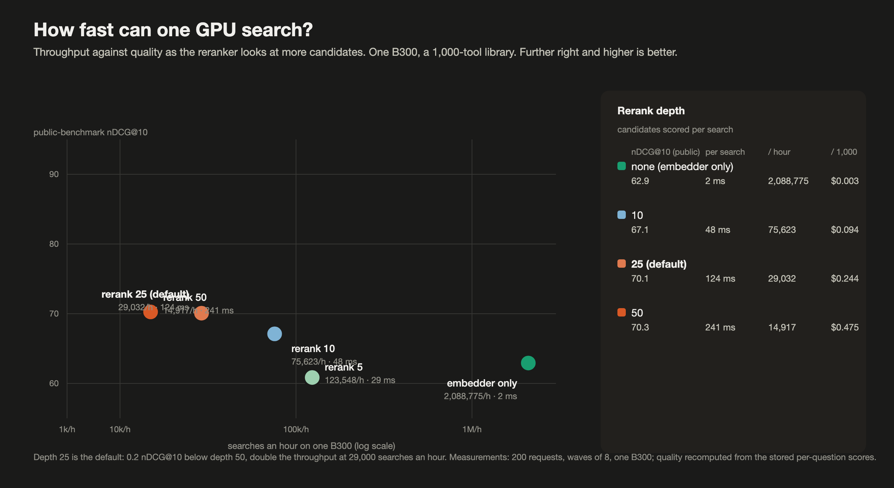
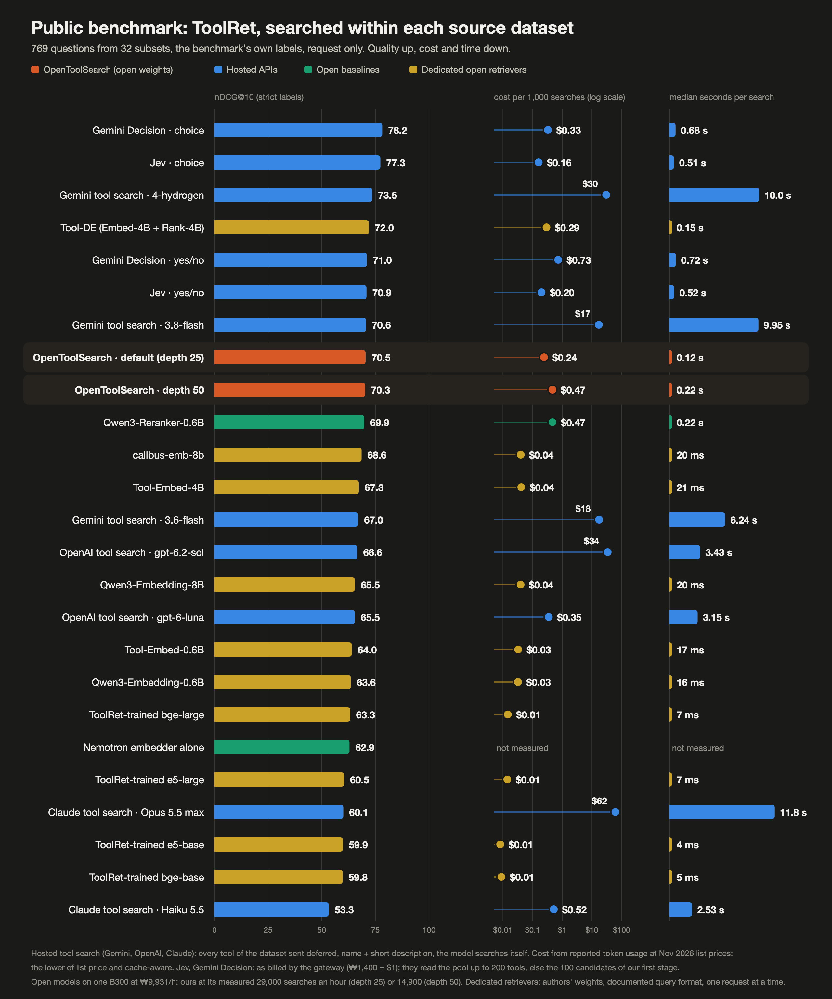
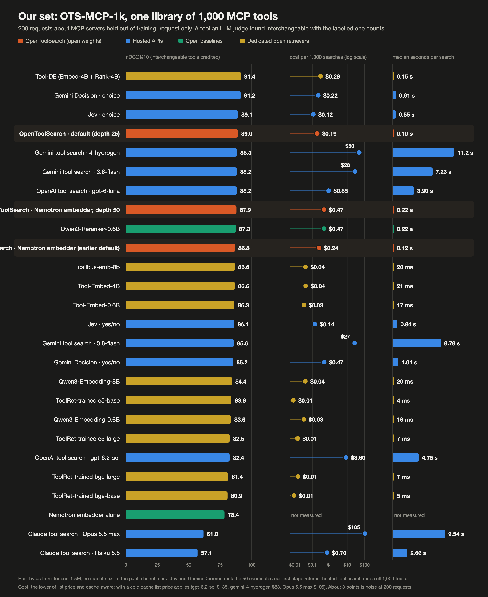
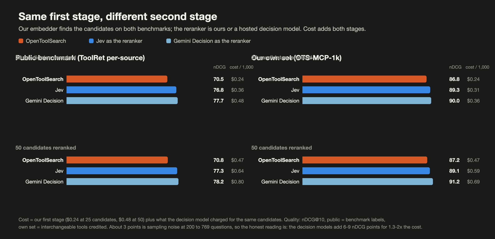
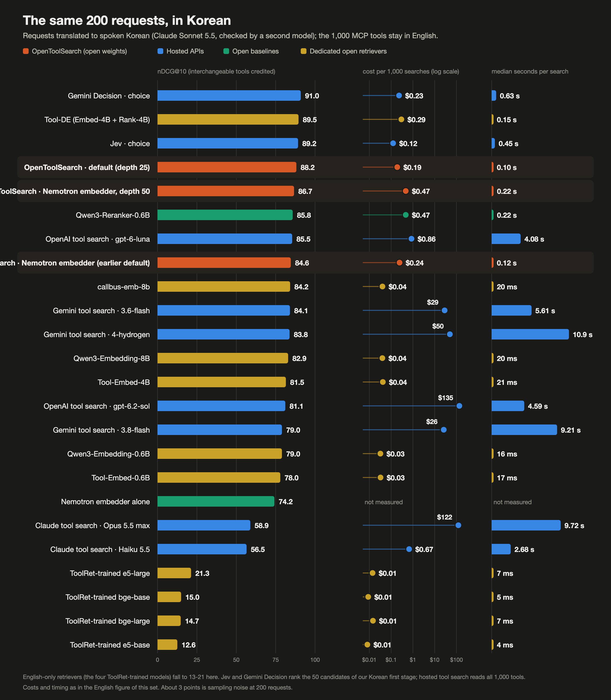
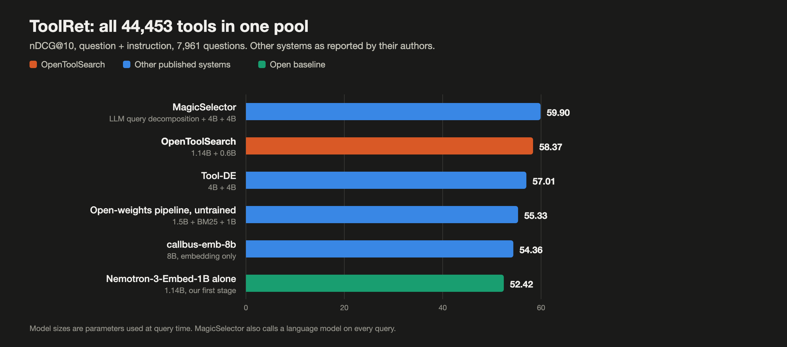

# OpenToolSearch - benchmarks, cost and throughput

The complete numbers behind the [README](README.md): every system we compared, the conditions it was
run under, the throughput and cost on rented GPUs, and the full ToolRet corpus. The raw data and
scripts are in [`benchmarks/`](benchmarks/README.md), every run (including the failed ones) with its
cost in [`results/LEDGER.md`](results/LEDGER.md).

## One GPU, thirty-seven thousand searches an hour

The default pair - OpenToolSearch Embed 0.6B and Rerank 0.6B, rerank depth 25, fusion 0.5 - run
through the library on one B300 (rented at $7.09 an hour) over the 1,000-tool library, 200 requests
([`scripts/v10_default_speed.py`](scripts/v10_default_speed.py), `results/default_speed*.json`):

| How requests arrive | Time per search | Searches an hour | $ per 1,000 (our pod) |
|---|---|---|---|
| One at a time, in sequence | 79 ms | 45,400 | $0.16 |
| **In waves of 8 requests (the figure used everywhere)** | **97 ms** | **37,200** | **$0.19** |
| In waves of 32 | 95 ms | 37,900 | $0.19 |
| *For comparison: rerank 50 candidates instead of 25, waves of 8* | *194 ms* | *18,500* | *$0.38* |

- **A single request**, warm, takes a median 66 ms (90th percentile 115 ms, mean 77 ms); embedding
  the request alone is 15.6 ms. Indexing the 1,000 tools takes 1.9 s. Waves of 8 are the setting this
  page has always used; it is not the cheapest of the three rows. A repeat run gave the same 96.9 ms.
- **The same script on the same machine for the other pairs:**

| First stage + our reranker | Own set nDCG@10, English / Korean (library run) | Time per search, waves of 8 | Searches an hour | $ per 1,000 | Single request, median |
|---|---|---|---|---|---|
| **OpenToolSearch Embed 0.6B (default)** | 88.8 / 88.2 | **97 ms** | 37,200 | **$0.19** | 66 ms |
| callbus-emb-8b (7.6B) | 89.8 / 88.6 | 104 ms | 34,600 | $0.20 | 70 ms |
| Nemotron-3-Embed-1B (the default before 0.2) | 86.1 / 84.4 | 116 ms | 31,000 | $0.23 | 84 ms |

  The reranker is what costs time; the first stage changes it by 7-20%. The 0.6B embedder is *slower*
  than Nemotron-3-Embed-1B for one request (15.6 against 8.6 ms), so its lead comes from the reranker
  side - probably the shorter candidate texts its first stage hands over; we did not isolate it. The
  library run scores within 0.4 points of the first-stage-swap table below (the library builds the
  tool text itself instead of rebuilding it from `bench.json`).
- **Cost:** $0.19 per 1,000 searches at the default depth. Hosted tool search costs $0.35-0.86 at the
  cheapest (gpt-6-luna with a warm prompt cache, Claude Haiku 5.5) and $9-105 for the flagship models
  and Gemini's flash tier (tables below).
- Hosted decision models (Jev, Gemini Decision) are cheap and fast too, but they only rank the
  candidates we hand them and return a list, not a service next to your data.

**How many candidates the reranker reads is a dial.** Measured earlier, with the Nemotron-3-Embed-1B first
stage (the default before 0.2) on a 1,000-tool library; the new pair was measured at depth 25 only. The
same machine type measured the Nemotron pair at 116 ms against 124 ms in this earlier run, so expect
about 7% run-to-run difference:

| Candidates reranked | nDCG@10 (public bench) | Per search | Searches an hour | $ per 1,000 (our pod) |
|---|---|---|---|---|
| none - embedder only | 62.9 | 1.7 ms | 2,088,000 | $0.003 |
| 10 | 67.1 | 48 ms | 75,600 | $0.09 |
| **25** | **70.1** | 124 ms | **29,000** | **$0.24** |
| 50 | 70.3 | 241 ms | 14,900 | $0.48 |

- **The default is rerank depth 25**: two and a half times the throughput of depth 50 for 0.2
  nDCG@10 - inside the noise of this benchmark. Depth 10 is another 2.6 times faster for 3 points.
  Depth and fusion weight were chosen with the Nemotron first stage. For the new pair we re-ran depth 50 against 25 (fusion 0.5):
  71.0 / 88.9 / 88.2 against 70.8 / 89.0 / 88.2 (public / own English / own Korean) - differences of +0.2 / -0.1 / +0.1 with
  intervals that all contain zero (`results/depth50_vs_25_bootstrap.json`) - at 194 ms and $0.38 per 1,000 instead of 97 ms and
  $0.19. Twice the time and money for no measurable gain, so 25 stays the default (a first stage that already puts every
  labelled tool in its top 25 for 98% of our own-set requests leaves the reranker little to find in places 26-50). Other
  fusion weights were not re-tried.
- The fusion weight that combines the two scores is 0.5 in the default (70.45 public / 86.77 own set
  with the Nemotron first stage, against 70.08 / 87.43 at 0.25); the difference is inside the noise
  either way.

## Benchmarks

Four views, published with the scripts and the raw outputs so they can be re-run
([`benchmarks/`](benchmarks/README.md)): a public benchmark, a set of our own, the same set in
Korean, and the full ToolRet corpus against other published systems. The first three run the
same systems under the same conditions.

**What is compared**

| Kind | Systems | How it was run |
|---|---|---|
| Hosted tool search - the feature Google, OpenAI and Anthropic ship | Google: gemini-4-hydrogen (top), gemini-3.8-flash (latest cost-efficient), gemini-3.6-flash. OpenAI: gpt-6.2-sol (latest), gpt-6-luna (cost-efficient). Anthropic: Opus 5.5 at effort max (top), Haiku 5.5 (cost-efficient) | Every tool of the library is sent deferred and the model calls the vendor's own search tool over it; request only. No embedder of ours is involved, and we score the tools the search returned, in order, not the model's final pick. Claude's search is a keyword (BM25) search and does not put the library in the context (about 2k input tokens per request); OpenAI's and Gemini's are server-side searches of undisclosed design, and the library counts as input tokens (about 67k and 30k). OpenAI and Haiku are forced to search (`tool_choice`); the others are not (Anthropic documents that Opus 5.5 and Fable 5.2 reject a forced tool choice, and Fable 5.2 did; Gemini's API has none). Reasoning depth: Opus at max effort, everything else at its default. |
| Hosted decision models | Jev, Gemini Decision (BizRouter `/v1/decisions`) | They rank the candidates our first stage hands them; they cannot search a library themselves. |
| Dedicated open tool-retrieval models | Tool-DE (Tool-Embed-4B and 0.6B, Tool-Rank-4B), callbus-emb-8b, the four ToolRet-trained retrievers (bge and e5, base and large); Qwen3-Embedding 8B and 0.6B as general references | Run by us on a B300 with the authors' weights and the query format their card documents (of those, the one that scores best on our English set); one request embedded at a time against precomputed tool vectors. |
| OpenToolSearch | 0.6B embedder + 0.6B reranker | Library default (0.2): rerank 25 candidates, fusion weight 0.5. Rows with the earlier default (1.14B NVIDIA Nemotron-3-Embed-1B as first stage) are marked as such. |

Not run: MagicSelector (no public weights found), ToolGen (a generative retriever, only GGUF
files published), gpt-6.2-astra, gemini-4-argon. Claude Fable 5.2 was run once on our own set
(64.5, $79 per 1,000) and dropped for cost; it is in [the ledger](results/LEDGER.md).

### 1. Public benchmark, against hosted tool search

[ToolRet](https://github.com/mangopy/tool-retrieval-benchmark) in its per-source setting (the
paper's Tables 10-11): each question is searched only among the tools of its own source dataset,
with the benchmark's own labels. Every subset whose pool has at most 2,000 tools is included -
32 of 35; the three left out have 3,605 to 16,072 tools, too many to hand to an API in one
request - with 25 questions per subset drawn with a fixed seed (769 in all). The
request alone, no instruction.

### 2. A set of our own

OTS-MCP-1k: one library of 1,000 real MCP tools and 200 requests about servers held out of
training, built by us from Toucan-1.5M. A returned tool counts if it is the labelled one or
one an LLM judge found interchangeable with it. **We built this set, so weigh it below the
public one**: the data resembles our training data, the candidates for "interchangeable" were
picked with our own embedder, and the published reranker saw training rows from these servers (the embedder did not).

### Same first stage, fair fight

The hosted decision models cannot search a library themselves, so in the table above they were
given the 50 candidates our embedder found (at the time NVIDIA's Nemotron-3-Embed-1B, the default before 0.2) (the embedder costs about $0.003 per 1,000 searches, so
leaving its price out changes nothing). Here both sides use the same first stage (ours), one only
swaps the second stage, and that $0.003 is added to the decision models' bill:

| Candidates | Second stage (same first stage underneath) | Public nDCG@10 | Own set nDCG@10 | Cost / 1,000 (public / own) |
|---|---|---|---|---|
| 25 | **OpenToolSearch reranker** (Nemotron first stage) | 70.5 | 86.8 | **$0.24** / **$0.24** |
| 25 | Jev | 76.8 | 89.3 | $0.12 / $0.07 |
| 25 | Gemini Decision | 77.7 | 90.0 | $0.24 / $0.12 |
| 50 | **OpenToolSearch reranker** (Nemotron first stage) | 70.8 | 87.2 | **$0.48** / **$0.48** |
| 50 | Jev | 77.3 | 89.1 | $0.16 / $0.12 |
| 50 | Gemini Decision | 78.2 | 91.2 | $0.33 / $0.22 |

- **As a second stage, the decision models are better and cheaper.** Swapping our reranker for Jev
  or Gemini Decision adds 6-7.5 nDCG points on the public benchmark and 1.9-4.0 on ours, at $0.07-0.33
  per 1,000 against our reranker's $0.24-0.48. (An earlier version of this table added $0.24 and
  $0.48 - our whole pipeline - as the "first stage" cost and wrongly showed them as dearer;
  corrected on 2026-11-22, see the [ledger](results/LEDGER.md).)
- **What ours has that they do not:** open weights on your own hardware, tool descriptions that
  never leave your machines, 0.10 s against 0.5-0.7 s per search, no API key and no rate limits.
  Both need a first stage; any retriever will do, including our embedder.
- **With the new default embedder** our pipeline scores 70.8 public and 89.0 on our set at $0.19 (the
  first-stage table below): on our set that is level with the decision models behind the Nemotron
  stage (89.1-89.3 at 25 candidates), on the public benchmark still 6 points below. We did not re-run
  the decision models on the new embedder's candidates (hosted API cost).
- **At 25 candidates the gap is smaller on our set (2.5-3.3) than on the public benchmark
  (6.3-7.2)** - the public benchmark's labels are stricter.

### Swapping the first stage

The reranker does not care which retriever hands it candidates. Eight first stages, each followed by
the same published reranker on its top 25 with fusion 0.5 (the library default), on the three tests:

<!-- table:firststage -->
| First stage | Alone (public / own / Korean) | + OpenToolSearch reranker | Gain | Every labelled tool in the top 25 |
|---|---|---|---|---|
| callbus-emb-8b (7.6B) | 68.6 / 86.6 / 84.2 | **71.8 / 89.4 / 89.0** | +3.2 / +2.8 / +4.8 | 84% / 100% / 98% |
| Nemotron-3-Embed-8B (8B) | 66.1 / 81.6 / 77.7 | **71.2 / 87.1 / 86.3** | +5.2 / +5.5 / +8.6 | 83% / 95% / 93% |
| Qwen3-Embedding-8B (7.6B) | 65.5 / 84.4 / 82.9 | **71.0 / 88.5 / 88.4** | +5.6 / +4.1 / +5.5 | 84% / 98% / 98% |
| Tool-Embed-4B (4.0B) | 67.3 / 86.6 / 81.5 | **71.0 / 89.2 / 85.8** | +3.7 / +2.6 / +4.3 | 82% / 98% / 95% |
| OpenToolSearch-Embed-0.6B (0.6B) - the library default | 66.0 / 85.9 / 80.4 | **70.8 / 89.0 / 88.2** | +4.8 / +3.1 / +7.7 | 83% / 98% / 98% |
| Qwen3-Embedding-0.6B (0.6B) - the base of OpenToolSearch Embed | 63.6 / 83.6 / 79.0 | **70.6 / 87.3 / 87.2** | +7.0 / +3.7 / +8.2 | 82% / 96% / 94% |
| Nemotron-3-Embed-1B (1.14B) - the library default before 0.2 | 63.0 / 79.0 / 74.0 | **70.4 / 86.2 / 84.7** | +7.4 / +7.2 / +10.7 | 81% / 94% / 92% |
| Tool-Embed-0.6B (0.6B) | 64.0 / 86.3 / 78.0 | **69.3 / 89.3 / 85.8** | +5.2 / +2.9 / +7.9 | 81% / 98% / 94% |
<!-- /table:firststage -->

- **The reranker helps every first stage**, by 2.6 to 10.7 points, most for the weakest.
- **The default embedder is the 0.6B one, OpenToolSearch Embed, fine-tuned from Qwen3-Embedding-0.6B.**
  Behind the reranker it scores 70.8 / 89.0 / 88.2 against 70.4 / 86.2 / 84.7 for the 1.14B
  Nemotron-3-Embed-1B that was the default before 0.2, with about half the parameters. By itself it is
  above its base (66.0 / 85.9 / 80.4 against 63.6 / 83.6 / 79.0) and puts every labelled tool in the
  top 25 for 98% of our own-set requests (base 96%, Nemotron 94%).
- **Behind the reranker, though, the base is close.** Qwen3-Embedding-0.6B with the same query format
  scores 70.6 / 87.3 / 87.2: the fine-tuned embedder is +0.2 / +1.7 / +1.0 above it, differences the
  test sets cannot establish (below). The second stage does most of the work.
- **A better first stage still makes a better pipeline.** callbus-emb-8b puts every labelled tool inside
  the top 25 for 100% of our own-set requests and 84% of the public questions (ours 98%, 83%), and the
  pipeline gains 1.0 / 0.4 / 0.8 points over the default one.
- **Against Tool-DE** (72.0 / 91.4 / 89.5, a 4B + 4B pair): the default pair is 1.2 / 2.4 / 1.3 points
  behind with 1.2B parameters against 8.0B.
- **The price of callbus-emb-8b is its size**: 7.6B parameters (16 GB) for the gains above, at about
  the same speed (104 against 97 ms per search, measured end to end).
- **A bigger general embedder is not enough.** Nemotron-3-Embed-8B, the teacher the 1B was
  distilled from, beats the 1B as a first stage (+0.8 / +0.9 / +1.6 points) but not callbus-emb-8b,
  which was trained on tool-retrieval data - nor the 0.6B default.
- **Eight first stages is not a survey.** Exact conditions: `scripts/v8_first_stage_rerank.py`
  (query formats as in the dedicated-retriever runs), scores `scripts/v8_score.py`, results
  `results/first_stage_plus_reranker.json`, top-50 candidates and final rankings in
  [`benchmarks/first-stage-swap/`](benchmarks/first-stage-swap/).

**How sure are these differences?** Paired bootstrap over requests (own set) and over questions within
each of the 32 subsets (public), 95% interval, `scripts/v10_paired_bootstrap.py`:

| Difference in nDCG@10 behind the same reranker | Public | Own set, English | Own set, Korean |
|---|---|---|---|
| OpenToolSearch Embed 0.6B minus Nemotron-3-Embed-1B | +0.4 [-0.7, +1.4] | **+2.8 [+0.5, +5.4]** | **+3.5 [+0.4, +6.8]** |
| OpenToolSearch Embed 0.6B minus its base, Qwen3-Embedding-0.6B | +0.2 [-0.7, +1.2] | +1.7 [-0.4, +3.8] | +1.0 [-1.6, +3.5] |
| callbus-emb-8b minus OpenToolSearch Embed 0.6B | **+1.1 [+0.3, +1.9]** | +0.4 [-0.8, +1.8] | +0.8 [-0.6, +2.2] |

Only the bold intervals exclude zero: the new embedder is better than the old default on our set, and
callbus-emb-8b is better than it on the public benchmark. Everything else is within noise.

### Swapping the second stage: what makes Tool-DE better?

Tool-DE scores higher than the default pair (72.0 / 91.4 / 89.5). Is that its 4B embedder or its 4B reranker? Three
first stages, each handing its top 25 to our reranker, to Tool-Rank-4B (Tool-DE's reranker, run as in the Tool-DE row: pointwise
yes/no, Qwen3-Reranker prompt, original tool text), or to both. The four scorings were fixed before the run
(`scripts/v11_second_stage_combos.py`; z-scores over the 25 candidates, first-stage weight 0.5 as in the library; nothing was
chosen on the results), public / own English / own Korean nDCG@10:

<!-- table:secondstage -->
| First stage (top 25) | Our reranker + first stage (library default) | Tool-Rank-4B alone | Tool-Rank-4B + first stage | Our reranker + Tool-Rank-4B + first stage |
|---|---|---|---|---|
| OpenToolSearch Embed 0.6B | **71.0 / 89.0 / 88.2** | 71.8 / 90.8 / 90.8 | 71.8 / 90.0 / 89.4 | 72.2 / 90.2 / 90.8 |
| Tool-Embed-4B | 70.9 / 89.3 / 86.0 | 72.0 / 91.4 / 89.2 | 72.3 / 90.0 / 88.0 | 72.8 / 90.8 / 88.9 |
| Tool-Embed-0.6B | 69.5 / 89.2 / 86.0 | 70.9 / 91.6 / 89.4 | 70.7 / 91.3 / 88.7 | 71.4 / 91.6 / 89.1 |
<!-- /table:secondstage -->

- **The control reproduces Tool-DE**: Tool-Embed-4B followed by Tool-Rank-4B alone scores 72.0 / 91.4 / 89.2 (earlier run:
  72.0 / 91.4 / 89.5). The left column differs from the first-stage table by up to 0.2 (bf16 batches are composed
  differently in the two runs).
- **Most of Tool-DE's lead is its reranker.** Behind our own 0.6B embedder, Tool-Rank-4B alone gives 71.8 / 90.8 / 90.8 - against
  72.0 / 91.4 / 89.2 behind Tool-Embed-4B: -0.2 / -0.7 / +1.6, none of them established (paired bootstrap below). A 4B embedder
  buys nothing here; a 4B reranker buys 0.8 / 1.7 / 2.6 points over ours behind the same first stage.
- **The same combination through the library** (`ToolIndex(reranker="Lux1997/Tool-Rank-4B", fuse=0.0)`, installed from GitHub): own set 90.8 English /
  91.1 Korean, 256 ms a search in waves of 8 (14,100 an hour, $0.50) - the benchmark scripts gave 90.8 / 90.8 and 249 ms
  (`results/default_speed_toolrank.json`).
- **That costs time.** Per search, waves of 8, embedding included: our reranker 96 ms (37,700 an hour, $0.19 per 1,000), Tool-Rank-4B
  249 ms (14,500 an hour, $0.49), both 342 ms (10,500 an hour, $0.67). Tool-DE's own 0.15 s in the tables above is a single-request
  median from an earlier run, not comparable to these.
- **Adding our reranker to Tool-Rank-4B** (last column) gives 72.2 / 90.2 / 90.8 behind our embedder and 72.8 / 90.8 / 88.9
  behind Tool-Embed-4B - the highest public scores of anything open we ran - but against Tool-Rank-4B alone the differences are
  +0.4 / -0.5 / 0.0 (behind Tool-Embed-4B +0.8 / -0.6 / -0.3, not tested separately): not established, for 37% more time.
- **Our reranker is the better value; Tool-Rank-4B is the better ranker.** For the same first stage our reranker is 2.6 times faster
  and 0.8-2.6 points lower; most of that gap is in Korean.
- **Caveats.** Tool-Rank-4B has no documented prompt and was run on the original tool texts, not the LLM-expanded ones it was
  trained with, so its numbers are a lower bound. 25 candidates, three first stages, one fusion weight: not a survey.

Paired bootstrap (95% interval; requests resampled on our set, questions within each subset on the public one), `scripts/v11_score.py`:

| Difference in nDCG@10 | Public | Own set, English | Own set, Korean |
|---|---|---|---|
| Behind OpenToolSearch Embed: Tool-Rank-4B alone minus our reranker | +0.8 [-0.4, +1.9] | +1.7 [0.0, +3.6] | **+2.6 [+0.5, +4.7]** |
| Behind OpenToolSearch Embed: our reranker + Tool-Rank-4B minus our reranker | **+1.2 [+0.5, +1.9]** | **+1.2 [+0.2, +2.4]** | **+2.6 [+1.2, +4.2]** |
| Behind OpenToolSearch Embed: our reranker + Tool-Rank-4B minus Tool-Rank-4B alone | +0.4 [-0.4, +1.2] | -0.5 [-2.0, +1.0] | 0.0 [-1.5, +1.6] |
| Behind Tool-Rank-4B alone: OpenToolSearch Embed minus Tool-Embed-4B | -0.2 [-1.0, +0.5] | -0.7 [-1.7, +0.2] | +1.6 [0.0, +3.4] |
| Tool-DE (Tool-Embed-4B, Tool-Rank-4B alone) minus OpenToolSearch default | +1.0 [-0.3, +2.3] | **+2.4 [+0.3, +4.6]** | +1.0 [-1.6, +3.5] |

Bold: the interval excludes zero. Tool-DE is established as better than the default pair only on our English set.

### 3. The same requests in Korean

The 200 requests of OTS-MCP-1k translated into spoken Korean by Claude Sonnet 5.5 and checked
by a second model (gemini-3.6-flash compared each English request with its Korean version:
197 of 200 rated 5 of 5; we fixed the other three by hand - one carried a stray introduction
line, two had dropped a word). The 1,000 tools stay in English, and the labels and the
interchangeable-tool sets are unchanged, so a system that understands Korean should score
what it scores in English. The translations are in
[`benchmarks/ots-mcp-1k-ko/`](benchmarks/ots-mcp-1k-ko/).

<!-- table:korean -->
| System | OTS-MCP-1k in English | … in Korean | Change | What it returns (Korean) |
|---|---|---|---|---|
| Gemini Decision — single choice (50 candidates) | 91.2 | 91.0 | -0.3 | ranks 50 candidates |
| Tool-DE (Tool-Embed-4B + Tool-Rank-4B) | 91.4 | 89.5 | -1.9 | embedding search, top 20 |
| Jev — single choice (50 candidates) | 89.1 | 89.2 | +0.1 | ranks 50 candidates |
| **OpenToolSearch — default (Embed 0.6B + Rerank 0.6B, depth 25)** † | 89.0 | 88.2 | -0.8 | ranks 25 candidates |
| OpenToolSearch — depth 50 † | 86.8 | 86.7 | -0.1 | ranks 50 candidates |
| Qwen3-Reranker-0.6B as released (depth 50) † | 86.3 | 85.8 | -0.5 | ranks 50 candidates |
| OpenAI tool search · gpt-6-luna | 88.2 | 85.5 | -2.7 | 1.8 tools; searched on 200 of 200 |
| OpenToolSearch reranker behind Nemotron-3-Embed-1B (earlier default, depth 25) † | 86.1 | 84.6 | -1.5 | ranks 25 candidates |
| callbus-emb-8b | 86.6 | 84.2 | -2.4 | embedding search, top 20 |
| Gemini API tool search · gemini-3.6-flash | 88.2 | 84.1 | -4.1 | 2.9 tools; searched on 194 of 199 |
| Gemini API tool search · gemini-4-hydrogen | 88.3 | 83.8 | -4.5 | 4.5 tools; searched on 188 of 200 |
| Qwen3-Embedding-8B | 84.4 | 82.9 | -1.5 | embedding search, top 20 |
| Tool-Embed-4B | 86.6 | 81.5 | -5.1 | embedding search, top 20 |
| OpenAI tool search · gpt-6.2-sol | 82.4 | 81.1 | -1.3 | 2.0 tools; searched on 200 of 200 |
| Gemini API tool search · gemini-3.8-flash | 85.6 | 79.0 | -6.6 | 2.7 tools; searched on 180 of 200 |
| Qwen3-Embedding-0.6B | 83.6 | 79.0 | -4.6 | embedding search, top 20 |
| Tool-Embed-0.6B | 86.3 | 78.0 | -8.4 | embedding search, top 20 |
| Nemotron-3-Embed-1B alone † | 79.0 | 74.2 | -4.8 | top 50 |
| Claude tool search · Opus 5.5 (effort max) | 61.8 | 58.9 | -2.8 | 30.8 tools; searched on 198 of 200 |
| Claude tool search · Haiku 5.5 | 57.1 | 56.5 | -0.6 | 9.6 tools; searched on 200 of 200 |
| ToolRet-trained-e5-large-v2 | 82.5 | 21.3 | -61.1 | embedding search, top 20 |
| ToolRet-trained-bge-base-en-v1.5 | 80.9 | 15.0 | -65.9 | embedding search, top 20 |
| ToolRet-trained-bge-large-en-v1.5 | 81.4 | 14.7 | -66.7 | embedding search, top 20 |
| ToolRet-trained-e5-base-v2 | 83.9 | 12.6 | -71.3 | embedding search, top 20 |
<!-- /table:korean -->

† The open systems were recomputed with the same tool texts for both languages, so their
change is like for like; their English column (86.1 for the earlier default) differs from the 86.8 of
the other tables because the tool texts here are rebuilt from the published `bench.json`
fields instead of the original Toucan text.

- **Hosted tool search loses 0.6 to 6.6 points** (gemini-3.8-flash the most: it skipped the
  search on 20 of 200 Korean requests, 9 of 200 in English). **OpenToolSearch loses 0.8** with the
  default pair (the embedder's training included a small share of machine-translated Korean
  requests - none of them these 200); the pair of the earlier default, with the Nemotron embedder,
  lost 1.5 at this depth and 0.1 at depth 50, and the second stage does most of the work the
  embedder alone loses (79.0 to 74.2).
- **The English-only retrievers collapse.** The four ToolRet-trained models fall from 81-84
  to 13-21. The multilingual ones hold up better when they are large (callbus-emb-8b -2.4,
  Qwen3-Embedding-8B -1.5, Tool-DE -1.9) and less when they are small (Qwen3-Embedding-0.6B
  -4.6, Tool-Embed-0.6B -8.4).
- **The decision models do not move** (91.2 to 91.0, 89.1 to 89.2): they are large language
  models, and our first stage still finds the right candidates.

### Both, in one table

<!-- table:one -->
| System | Kind | ToolRet per-source nDCG@10 | Recall@10 | OTS-MCP-1k nDCG@10 | …in Korean | Cost / 1,000 searches | Median latency |
|---|---|---|---|---|---|---|---|
| Gemini Decision — single choice | hosted decision model (ranks our candidates) | 78.2 | 87.2 | 91.2 | 91.0 | $0.33 | 0.68 s |
| Jev — single choice | hosted decision model (ranks our candidates) | 77.3 | 85.4 | 89.1 | 89.2 | $0.16 | 0.51 s |
| Gemini API tool search · gemini-4-hydrogen | hosted tool search | 73.5 | 79.4 | 88.3 | 83.8 | $30 (list $51) | 10.0 s |
| Tool-DE (Tool-Embed-4B + Tool-Rank-4B) (8.0B) | dedicated open retriever | 72.0 | 83.1 | 91.4 | 89.5 | $0.29 | 0.149 s |
| Gemini Decision — yes/no per tool | hosted decision model (ranks our candidates) | 71.0 | 85.4 | 85.2 | — | $0.73 | 0.72 s |
| Jev — yes/no per tool | hosted decision model (ranks our candidates) | 70.9 | 84.8 | 86.1 | — | $0.20 | 0.52 s |
| **OpenToolSearch — default (OpenToolSearch Embed 0.6B + Rerank 0.6B, depth 25)** | open weights | **70.8** | — | **89.0** | **88.2** | $0.19 | 0.10 s |
| Gemini API tool search · gemini-3.8-flash | hosted tool search | 70.6 | 75.3 | 85.6 | 79.0 | $17 (list $28) | 9.95 s |
| OpenToolSearch reranker behind Nemotron-3-Embed-1B (the earlier default, depth 25) | open weights | 70.5 | 82.1 | 86.8 | 84.6 | $0.24 | 0.12 s |
| OpenToolSearch — depth 50 | open weights | 70.3 | 82.4 | 87.9 | 86.7 | $0.47 | 0.22 s |
| Qwen3-Reranker-0.6B as released | open baseline | 69.9 | 81.7 | 87.3 | 85.8 | $0.47 | 0.22 s |
| callbus-emb-8b (7.6B) | dedicated open retriever | 68.6 | 81.5 | 86.6 | 84.2 | $0.04 | 0.020 s |
| Tool-Embed-4B (4.0B) | dedicated open retriever | 67.3 | 80.0 | 86.6 | 81.5 | $0.04 | 0.021 s |
| Gemini API tool search · gemini-3.6-flash | hosted tool search | 67.0 | 71.6 | 88.2 | 84.1 | $18 (list $28) | 6.24 s |
| OpenAI tool search · gpt-6.2-sol | hosted tool search | 66.6 | 68.1 | 82.4 | 81.1 | $34 | 3.43 s |
| Qwen3-Embedding-8B (7.6B) | general embedder, reference | 65.5 | 78.2 | 84.4 | 82.9 | $0.04 | 0.020 s |
| OpenAI tool search · gpt-6-luna | hosted tool search | 65.5 | 65.2 | 88.2 | 85.5 | $0.35 (list $1.74) | 3.15 s |
| Tool-Embed-0.6B (596M) | dedicated open retriever | 64.0 | 77.6 | 86.3 | 78.0 | $0.03 | 0.017 s |
| Qwen3-Embedding-0.6B (596M) | general embedder, reference | 63.6 | 77.4 | 83.6 | 79.0 | $0.03 | 0.016 s |
| ToolRet-trained-bge-large-en-v1.5 (335M) | dedicated open retriever | 63.3 | 77.0 | 81.4 | 14.7 | $0.01 | 0.007 s |
| Nemotron-3-Embed-1B alone | open baseline | 62.9 | 76.6 | 78.4 | 74.2 | $0.00 | 0.002 s |
| ToolRet-trained-e5-large-v2 (335M) | dedicated open retriever | 60.5 | 73.8 | 82.5 | 21.3 | $0.01 | 0.007 s |
| Claude tool search · Opus 5.5 (effort max) | hosted tool search | 60.1 | 66.2 | 61.8 | 58.9 | $62 | 11.8 s |
| ToolRet-trained-e5-base-v2 (109M) | dedicated open retriever | 59.9 | 73.8 | 83.9 | 12.6 | $0.01 | 0.004 s |
| ToolRet-trained-bge-base-en-v1.5 (109M) | dedicated open retriever | 59.8 | 73.5 | 80.9 | 15.0 | $0.01 | 0.005 s |
| Claude tool search · Haiku 5.5 | hosted tool search | 53.3 | 60.9 | 57.1 | 56.5 | $0.52 | 2.53 s |
<!-- /table:one -->

What the numbers say, plainly:

- **Default settings are depth 25 and fusion 0.5**: 70.8 on the public benchmark at 37,000
  searches an hour and $0.19 per 1,000 (with the earlier Nemotron embedder: depth 25 70.5, depth 50
  70.8, at 29,000 and 15,000 an hour - two and a half times the throughput and half the cost of depth 50
  for about 0.3 nDCG points, inside the noise of a 769-question test).
- **Quality: in the middle on the public benchmark, level with the best on ours.** On the public
  benchmark OpenToolSearch (70.8) is above OpenAI's tool search (gpt-6.2-sol 66.6, gpt-6-luna 65.5),
  Claude's (Opus 5.5 60.1, Haiku 5.5 53.3) and Gemini 3.6-flash (67.0), level with
  gemini-3.8-flash (70.6), 2.7 points below gemini-4-hydrogen (73.5) and 6 below Jev and Gemini
  Decision asked to pick one tool. On our own set it is 89.0 against 88.2-88.3 for gpt-6-luna,
  gemini-3.6-flash and gemini-4-hydrogen - level, since 200 requests cannot separate 3 points -
  and above gpt-6.2-sol (82.4), gemini-3.8-flash (85.6) and Claude (57-62). In Korean it is 88.2
  against 85.5 at best (gpt-6-luna). Among open models only Tool-DE is above it (72.0 public,
  91.4 own, 89.5 Korean).
- **Speed and cost: first among the systems that search a whole library, by a wide margin.**
  0.10 s and $0.19 per 1,000 searches, against 2.5-12 s and $0.35-105 for hosted tool search.
  The hosted tool search of the cheapest tier (gpt-6-luna, Haiku 5.5) is within a factor of
  three on cost; everything else is 90 to 550 times more expensive. The dedicated embedding
  retrievers without a second stage are faster and cheaper still - 4-21 ms and $0.01-0.04 - but
  score lower, and the English-only ones fall apart in Korean. Tool-DE, which adds a reranker,
  takes 0.15 s ($0.29), a little more than ours.
- **Bigger or newer is not better at this job.** gpt-6.2-sol scores below gpt-6-luna on our set
  (82.4 against 88.2; with search forced both look up about two tools per request, sol
  thinking about a third as long) and about the same on the public one; gemini-3.8-flash is
  above 3.6-flash on the public benchmark (70.6 against 67.0) and below it on ours (85.6
  against 88.2). Claude Opus 5.5 at max effort scores 5-7 points above Haiku 5.5 for about 120
  times the cost; Claude's tool search is a keyword (BM25) search, so the model only changes
  the query it sends.
- **The best open competitor is Tool-DE** (Tool-Embed-4B retrieving 25 candidates, Tool-Rank-4B
  reranking them): 72.0 public, 91.4 own, 89.5 Korean against our 70.8, 89.0, 88.2 - ahead by
  1.2, 2.4 and 1.3 points, with 8.0B parameters against our 1.2B, at 0.15 s per search. It was
  trained for tool descriptions expanded by an LLM, which we did not generate, so what we ran
  is its weaker setting. We cannot tell how much of its lead on our own set comes from training
  data overlapping Toucan, the source of that set. On ToolRet's whole 44,453-tool corpus the
  figure its authors report (57.0) is below ours (58.4, measured with the earlier Nemotron first stage), so
  the two do not simply rank one way.
- **callbus-emb-8b** (Qwen3-Embedding-8B trained further on ToolRet's training split) scores
  68.6 public, 86.6 own, 84.2 Korean. It is an embedding model with no second stage: 20 ms and
  $0.04 per 1,000 searches, but 7.6B parameters (16 GB) against our 1.2B, and 2.2 points
  below ours on the public benchmark.
- **Fine-tuning the reranker adds little here.** The released Qwen3 reranker scores 69.9 on the same
  (Nemotron) first stage at the same depth. The gain shows on the full ToolRet corpus below (51.9 to 56.0 on its
  own), where an instruction accompanies each question.
- **Open weights, run it yourself.** Ours, the dedicated retrievers and Tool-DE can be run on
  your own hardware with no per-search fee, and the tool library never leaves your machines;
  the hosted rows cannot.

How to read the columns. **Hosted costs** are computed from the token usage each API reported
at the list prices of Nov 2026 (BizRouter's model catalogue). The cell shows the lower of two
numbers - the list price, every input token at the full rate, and the cache-aware cost, the
cache hits the API reported billed at the cache-read price - with the list price in brackets
when the cache made it cheaper. Tool search re-sends the library on every call, so the prompt
cache decides the bill. gpt-6.2-sol's cache did not hit in three of its four complete runs (every
request wrote the cache, 25% above list), so its public-set cell is the list price; in the run
where it hit it cost $8.60 per 1,000 on our own set instead of $135, and the same applies to
Gemini, whose 4-hydrogen runs at $88 per 1,000 on our set without cache hits and $50 with
them. Claude's tool search does not re-send the library, so it has no cache effect.
Jev and Gemini Decision: KRW billed by the gateway, at 1,400 per USD. **Open models:**
GPU time on one NVIDIA B300 at the ₩9,931/h ($7.09/h) list price of the GPU we rented. The
default setting is priced at its measured throughput (37,000 searches an hour, waves of 8 requests); the
dedicated retrievers at their median time to embed one request. The latency shown for our pipelines is
the time per search at that throughput; a single request takes a median 66 ms. **Latency** for hosted APIs is the
wall-clock time of the API call from our network. Jev and Gemini Decision read the whole tool
pool when it has at most 200 tools (22 of the 32 public subsets) and otherwise the 100
candidates of our first stage (50 on OTS-MCP-1k); on the 22 full-pool subsets they score
85.7 and 86.3 (single choice) against our 75.6. Their "single choice" mode returns a
probability per tool rounded to two decimals; ties keep the order the tools were listed in.
Systems that were not forced to search skipped it on some requests, which count as misses:
on the public benchmark Gemini 3.6-flash on 38 of 769, 3.8-flash on 56, 4-hydrogen on 39 and
Opus 5.5 on 18; OpenAI and Haiku never skipped. Gemini 3.6-flash returned an error on 6 public
questions and 3.8-flash on 1, also counted as misses. One question with an empty request is
excluded for every system. OpenAI refused one tool name of the public set (`history`, a
reserved name); that tool was sent as `history_` and mapped back.

**Hosted tool search in detail**

<!-- table:hosted -->
| Vendor | Model | Role | Setting | ToolRet per-source | OTS-MCP-1k | …in Korean | $ / 1,000 on OTS-MCP-1k: list → with cache hits | Median latency |
|---|---|---|---|---|---|---|---|---|
| Google | gemini-4-hydrogen | top | thinking level not set; search not forced | 73.5 | 88.3 | 83.8 | $88 → $50 | 11.2 s |
| Google | gemini-3.8-flash | cost-efficient (latest) | thinking level not set; search not forced | 70.6 | 85.6 | 79.0 | $47 → $27 | 8.78 s |
| Google | gemini-3.6-flash | cost-efficient (previous) | thinking level not set; search not forced | 67.0 | 88.2 | 84.1 | $47 → $28 | 7.23 s |
| OpenAI | gpt-6.2-sol | latest | reasoning effort not set (default); search forced | 66.6 | 82.4 | 81.1 | $135 → $8.60 | 4.75 s |
| OpenAI | gpt-6-luna | cost-efficient | reasoning effort not set (default); search forced | 65.5 | 88.2 | 85.5 | $6.81 → $0.85 | 3.90 s |
| Anthropic | Opus 5.5 (effort max) | top | effort max, adaptive thinking; search not forced (documented as refused) | 60.1 | 61.8 | 58.9 | $105 → $105 | 9.54 s |
| Anthropic | Haiku 5.5 | cost-efficient | effort not set (default medium); search forced | 53.3 | 57.1 | 56.5 | $0.70 → $0.70 | 2.66 s |
<!-- /table:hosted -->

**Dedicated open tool-retrieval models**

<!-- table:dense -->
| Model | Weights | Query format | ToolRet per-source | OTS-MCP-1k | …in Korean | ms per search | $ / 1,000 |
|---|---|---|---|---|---|---|---|
| Tool-DE (Tool-Embed-4B + Tool-Rank-4B) (8.0B) | `Lux1997/Tool-Embed-4B + Lux1997/Tool-Rank-4B` | qwen3-default-instruction | 72.0 | 91.4 | 89.5 | 149.4 | $0.29 |
| callbus-emb-8b (7.6B) | `yasinyaman/callbus-emb-8b@v0.2` | callbus-instruction | 68.6 | 86.6 | 84.2 | 20.3 | $0.04 |
| Tool-Embed-4B (4.0B) | `Lux1997/Tool-Embed-4B` | tool-prompt | 67.3 | 86.6 | 81.5 | 21.1 | $0.04 |
| Qwen3-Embedding-8B (7.6B) | `Qwen/Qwen3-Embedding-8B` | callbus-instruction | 65.5 | 84.4 | 82.9 | 20.1 | $0.04 |
| Tool-Embed-0.6B (596M) | `Lux1997/Tool-Embed-0.6B` | tool-prompt | 64.0 | 86.3 | 78.0 | 16.6 | $0.03 |
| Qwen3-Embedding-0.6B (596M) | `Qwen/Qwen3-Embedding-0.6B` | callbus-instruction | 63.6 | 83.6 | 79.0 | 16.3 | $0.03 |
| ToolRet-trained-bge-large-en-v1.5 (335M) | `mangopy/ToolRet-trained-bge-large-en-v1.5` | bge-instruction | 63.3 | 81.4 | 14.7 | 7.4 | $0.01 |
| ToolRet-trained-e5-large-v2 (335M) | `mangopy/ToolRet-trained-e5-large-v2` | query | 60.5 | 82.5 | 21.3 | 7.2 | $0.01 |
| ToolRet-trained-e5-base-v2 (109M) | `mangopy/ToolRet-trained-e5-base-v2` | query | 59.9 | 83.9 | 12.6 | 4.1 | $0.01 |
| ToolRet-trained-bge-base-en-v1.5 (109M) | `mangopy/ToolRet-trained-bge-base-en-v1.5` | plain | 59.8 | 80.9 | 15.0 | 4.5 | $0.01 |
<!-- /table:dense -->

Weights and revisions are listed so the runs can be repeated; the query format is the one of
those documented on each card (or, for the Qwen3-based models, the instruction of callbus-emb-8b)
that scored best on our English set, used unchanged on every benchmark.

**Throughput, one GPU.** The default pair, measured on an NVIDIA B300 over the 1,000-tool library
(first table of this page): 97 ms per search in waves of 8, **37,200 searches an hour**, and a median
66 ms for a single request. Concurrency barely changes the cost per search here (79 ms one at a time,
95 ms in waves of 32): one search's rerank batch already fills the GPU, so serving requests together
mostly stops the card idling between them. At $7.09 an hour a search costs **$0.00019**.

The earlier measurement of the Nemotron-first-stage pair at depth 50: 0.216 s for a single request
(median), 0.239 s in waves of 4 to 32, 15,000 an hour, $0.42-0.47 per 1,000; its CPU run (8 vCPU, fp32)
took a median 57.5 s per search ($7.61 per 1,000), so a GPU is needed in practice. The H100 was not
measured (every H100 on our cluster was rented out for days).

**What it costs at market GPU prices.** The default pair's time per search (97 ms, waves of 8) x the
B300's price:

| B300 price source | $/GPU-hour | $/1,000 searches (1,000-tool library) |
|---|---|---|
| Runpod, community cloud | 6.94 | **0.19** |
| our own pods (₩9,931/h) | 7.09 | 0.19 |
| Oracle, 3-year commitment | 7.50 | 0.20 |
| Runpod, secure cloud | 8.99 | 0.24 |
| Nebius | 9.50 | 0.26 |
| market median (45 providers) | 10.76 | 0.29 |
| Spheron / Verda | 11.47-11.93 | 0.31-0.32 |
| Oracle, on-demand | 15.00 | 0.40 |
| AWS capacity block (prepaid) | 16.15 | 0.43 |

- **Cheaper than the flagship hosted tool search by 21 to 560 times** (21 at the most expensive B300
  quote, 560 at the cheapest). Those cost $9-105 per 1,000 searches (cache hits counted); ours is $0.19-0.43. Against the
  cheapest hosted ones (gpt-6-luna, Haiku 5.5: $0.35-0.86) it costs about the same at the dearest GPU
  quotes and about a quarter to a half as much at the cheap ones - and answers in 0.10 s instead of
  2.5-4 s.
- Even priced against the hosted decision models ($0.16-0.73 per 1,000, but those read only the
  candidates we give them), the gap is small, and **ours is open weights on your own metal**.

### 4. The full ToolRet corpus, against published systems

ToolRet (ACL 2025): 7,961 questions, 44,453 tools from 35 source datasets. Every question
is searched against **all** tools in one pool. nDCG@10; the headline is the mean of the three
categories (web, code, customized), each the mean of its subsets - the paper's aggregation.

**Question + instruction**

| System | Size | nDCG@10 | Notes |
|---|---|---|---|
| MagicSelector | LLM query decomposition + 4B embedder + 4B reranker | 59.90 | as reported, arXiv 2607.17751 |
| **opentoolsearch, track B** (Nemotron first stage) | 1.14B embedder + 0.6B reranker | **58.48** | track A data + the *training* split of Gorilla APIBench; top 50 |
| **opentoolsearch, track A** (Nemotron first stage) | 1.14B embedder (as released) + 0.6B reranker | **58.37** | clean ToolRet-train + two outside sources; reranking the top 100 (58.15 with the top 50) |
| Tool-DE (Tool-Embed-4B + Tool-Rank-4B) | 4B + 4B, LLM-expanded tool docs | 57.01 | as listed in the MagicSelector paper (56.44 in its own, arXiv 2510.22670) |
| Open-weights pipeline, nothing trained | 1.5B embedder + BM25 + 1B reranker | 55.33 | as reported, Savirinc/toolret-open-weights |
| callbus-emb-8b, embedding only | 8B | 54.36 (FP8: 54.53) | as reported on its model card |
| Nemotron-3-Embed-1B, as released | 1.14B | 52.42 | our run; the first stage of both tracks |

These two rows use NVIDIA's Nemotron-3-Embed-1B as first stage, the default before 0.2; the default pair
of 0.2 (OpenToolSearch Embed 0.6B + Rerank 0.6B) was not run on this setting.

So: **not the top of the table.** opentoolsearch is 1.5 points (track A) below the best reported
system, and above every other system we found, with models roughly a fifth of the size and
no LLM call at query time. Other systems' numbers are their authors'; we did not re-run them here (callbus-emb-8b and Tool-DE
were run on our per-source benchmarks above).

Two more views of the same track A run:

| | opentoolsearch track A | Best other figure we found |
|---|---|---|
| Question alone (no instruction), category mean, top 50 | **42.42** | 41.96 (open-weights pipeline) |
| Question + instruction, all questions pooled, top 100 | **62.47** | 59.36 (callbus-emb-8b + Qwen3-Reranker-8B) |

Track A with instruction, top 100: Recall@10 68.00, Completeness@10 56.26.

**How to read these numbers**

- The fusion weight is the only thing tuned against test questions, and it is *cross-fitted*:
  the questions are split in two halves, the weight is picked on one half and scored on the
  other, both ways. With the top 100, a fixed w = 0.25 gives 58.37 and w = 0.5 gives 58.19.
- Model choices (which base, whether to fine-tune the embedder, the augmentation) were made
  while looking at test scores. Every such run is listed in
  [`results/LEDGER.md`](results/LEDGER.md), including the ones that lost.
- ToolRet's instructions were written by a model that was shown the answer tools (the
  paper's "target-aware strategy"), so the with-instruction setting is easier than a plain
  request. The no-instruction row is the closer one to production traffic.
- Many subsets are small (11 to 50 questions). Differences under about half a point between
  runs are within what changes from one training run to the next.
- Track B uses in-domain training data for 3 of the 35 subsets (the Gorilla ones); read it
  as a supervised result for those, not as generalisation.
- The 18,422 training rows we removed are near-copies of test questions. Systems trained on
  ToolRet-train without such a filter have seen (close copies of) some test questions; we
  cannot tell from the outside how much that helps them.
