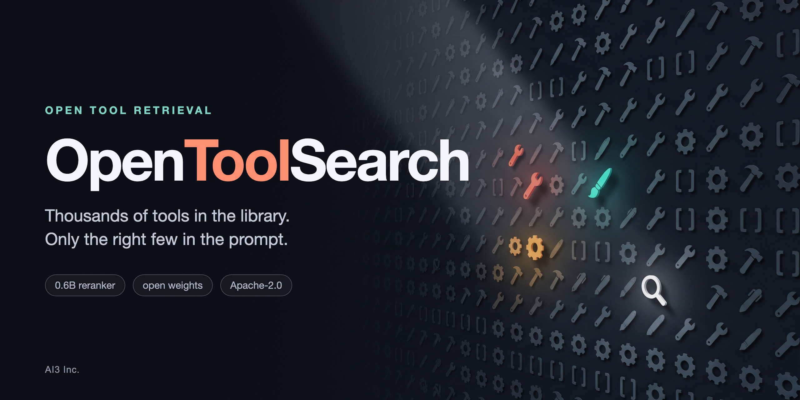
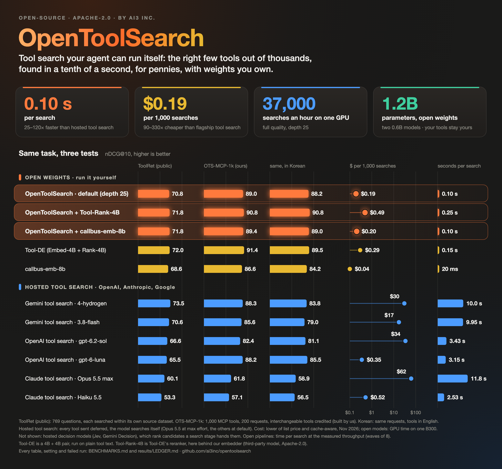

<p align="center">
  
</p>

<p align="center">
  <a href="README.md"><b>English</b></a> ·
  <a href="https://huggingface.co/ai3inc/opentoolsearch-embed-0.6b"><b>임베더</b></a> ·
  <a href="https://huggingface.co/ai3inc/opentoolsearch-rerank-0.6b"><b>리랭커</b></a> ·
  <a href="#벤치마크">벤치마크</a> ·
  <a href="BENCHMARKS.md">전체 벤치마크 표 (영문)</a> ·
  <a href="results/LEDGER.md">우리가 돌린 모든 실행 (영문)</a>
</p>

# OpenToolSearch

**에이전트를 위한 오픈소스 도구 검색.** 함수 선언, MCP 서버, 스킬처럼 수백~수천 개의 도구를 에이전트에게 맡기되,
요청 하나에 필요한 몇 개만 불러오게 합니다.

모델 API들이 이 기능을 호스티드 서비스로 내놓고 있습니다. OpenToolSearch는 같은 아이디어를 직접 돌릴 수 있는
오픈 가중치로 만든 것이고, 함수를 호출할 수 있는 어떤 모델과도 함께 쓸 수 있습니다. 0.6B 임베더가 후보를 찾고
0.6B 리랭커가 순서를 정합니다. 두 모델 모두 우리 모델이고 Apache-2.0이며, 한 단계씩 다른 모델로 바꿔 끼울 수도 있습니다.

> 이 문서는 영문 [README.md](README.md)의 한국어판입니다. 수치와 주장은 같고, 표의 이름과 상세 문서(BENCHMARKS, 원장)는 영문입니다.

## 왜 OpenToolSearch인가

- **빠르고 쌉니다.** GPU 한 장에서 검색 1회에 0.10초, 1,000회에 $0.19입니다(시간당 37,000건). Google·OpenAI·Anthropic의
  호스티드 도구 검색보다 25~120배 빠르고, 플래그십 모델보다는 90~330배 쌉니다. 가장 싼 호스티드 모델(gpt-6-luna,
  Haiku 5.5)도 우리의 2~3배 비용이 듭니다.
- **크고 계속 바뀌는 라이브러리를 위해 만들었습니다.** MCP 도구나 스킬을 추가·수정·삭제하면 16ms 뒤에 바로 검색됩니다. 나머지를 다시 임베딩할 필요도,
  벡터 데이터베이스도 없습니다([아래](#크고-계속-바뀌는-라이브러리를-위해-만들었습니다)).
- **오픈 가중치, 내 하드웨어.** 전체 1.2B 파라미터(임베더 0.6B + 리랭커 0.6B), Apache-2.0입니다. 도구 라이브러리가
  내 머신 밖으로 나가지 않습니다.
- **품질은 경쟁력이 있습니다.** 공개 벤치마크에서 OpenAI와 Claude의 호스티드 도구 검색, Gemini 3.6-flash보다 높고,
  Gemini 3.8-flash와 비슷하며, gemini-4-hydrogen에는 2.7점 뒤집니다. 우리 자체 세트와 한국어에서는 모든 호스티드 도구
  검색과 비슷하거나 높습니다(요청 200개로는 3점 차이를 가릴 수 없습니다). 8B 오픈 조합인 Tool-DE가 여전히 더 높고,
  그 차이의 대부분은 4B 리랭커에서 옵니다. 우리 임베더 뒤에 Tool-Rank-4B를 붙이면 71.8 / 90.8 / 90.8이 나오며 시간은
  2.6배 걸립니다. 더 큰 1단(callbus-emb-8b) 뒤에서는 우리 리랭커가 기본 임베더일 때보다 1.0 / 0.4 / 0.8점 더 좋습니다.
- **영어 중심, 한국어는 검증했습니다.** 주로 영어로 학습하고 평가했으며, 임베더 학습에는 기계번역한 한국어 요청이
  일부 들어 있습니다. 영어 도구 설명에 대한 한국어 요청은 0.8점 손해입니다(호스티드 Gemini 도구 검색은 4~7점 손해).
  다른 언어는 평가하지 않았습니다.
- 우리가 돌린 모든 실행은, 실패한 것까지 [기록으로 남겨 두었습니다](results/LEDGER.md).

## 크고 계속 바뀌는 라이브러리를 위해 만들었습니다

MCP 서버와 스킬은 수백, 수천 개로 쌓이고, 새것은 매일, 고친 것은 매시간 나옵니다. 전부 프롬프트에 넣는 것은 선택지가 아니고(우리 시험
라이브러리 도구 1,000개는 118,000토큰, 스킬 59개는 16,600토큰), 라이브러리가 바뀌면 흔한 해법들은 다루기 까다로워집니다.

OpenToolSearch는 라이브러리를 내 프로세스 안의 작은 인덱스로 들고 있고, 그 인덱스를 최신으로 유지하는 비용이 거의 없습니다.

| 도구 1,000개 라이브러리, B300 한 장 | 시간 | 임베딩한 텍스트 |
|---|---|---|
| 새 도구·스킬 추가 | 16ms | 1 |
| 설명 수정 | 17ms | 1 |
| 하나 삭제 | 1ms 미만 | 0 |
| 라이브러리 재스캔(수정 35, 추가 5, 삭제 5, `sync`) | 143ms | 40 |
| 인덱스 저장 / 불러오기(4.6MB) | 14ms / 4ms | 0 |
| 처음부터 만들기 | 0.9초 | 1,000 |

```python
import os
from opentoolsearch import ToolIndex

index = ToolIndex.load("tool_index/") if os.path.exists("tool_index/meta.json") else ToolIndex()
index.sync(지금의_모든_도구와_스킬)               # 새것·바뀐 것만 임베딩하고, 사라진 것은 뺍니다
index.save("tool_index/")
hits = index.search(최근_대화, k=5)             # 검색 0.10초, 1,000회 $0.19. 이 5개 정의만 모델에게 갑니다
```

벡터 데이터베이스도, 매일 밤 다시 임베딩하는 작업도 필요 없습니다. 사용자가 1분 전에 만든 스킬도 다음 호출에서 바로 검색됩니다. 임베더는 도구를
하나씩 따로 읽기 때문에 하나를 더하거나 고쳐도 다른 벡터는 바뀌지 않고, 인덱스는 전체를 다시 만든 것과 같은 벡터를 가집니다(요청 200개 중
200개에서 상위 5개가 동일, [측정](BENCHMARKS.md#a-library-that-changes-what-keeping-the-index-current-costs)). `examples/skill_search.py`가 `SKILL.md` 폴더에 대해 이것을 해 줍니다.

| | 호스티드 도구 검색(Google, OpenAI, Anthropic) | 호스티드 결정 모델(Jev, Gemini Decision) | **OpenToolSearch** |
|---|---|---|---|
| 도구 1,000개 이상 | 가능, 매 호출마다 라이브러리를 보내서(Gemini·OpenAI는 검색당 입력 30,000~67,000토큰) | **불가** - 받은 후보의 순위를 매길 뿐이고, 혼자서는 도구 약 200개까지만 풀 전체를 읽습니다(Gemini Decision은 선택지 최대 255개) | **가능** - 인덱스가 곧 검색 |
| 도구를 하나 추가하면 | 업체가 받는 라이브러리가 바뀜 | 색인할 것은 없지만, 후보를 찾는 다른 무언가가 필요 | **벡터 하나, 16ms** |
| 도구 설명이 가는 곳 | 매 호출마다 업체로 | 매 호출마다 API로 | **내 프로세스 안에 머뭄** |
| 검색 1,000회 비용 | $0.35~105 | 1단 비용 외에 $0.07~0.33 | **$0.19** |
| 검색 1회 시간 | 2.5~12초 | 0.5~0.7초 | **0.10초** |

**가장 잘 맞는 곳:** 사용자가 서버를 추가하는 에이전트 플랫폼과 MCP 마켓플레이스, 매일 바뀌는 사용자별·팀별 스킬 라이브러리, 권한 뒤에 있는 사내 도구
카탈로그(`allowed=[...]`, 도구 설명이 머신 밖으로 나가지 않음), 검색이 잦아서 1,000회 $0.19가 의미 있는 모든 곳(GPU 한 장에서 시간당 37,000건).
**맞지 않는 곳:** 도구 200개 이하의 카탈로그(결정 모델에게 목록 전체를 주거나 그냥 목록을 보여 주세요), 그리고 거의 같은 도구 사이의 마지막 선택입니다. 그
경우에는 OpenToolSearch가 찾은 후보 위에 결정 모델을 얹으세요(우리가 잰 최고 품질: Jev로 공개 벤치마크 76.8~77.3,
[수치](BENCHMARKS.md#same-first-stage-fair-fight)). Jev 같은 결정 모델은 라이브러리를 검색하지도, 라이브러리가 바뀌는 것을 따라가지도 못합니다.
OpenToolSearch가 바로 그것을 하므로 둘은 함께 씁니다. 스킬은 작은 비공개 세트로만 확인했고([점검](BENCHMARKS.md#a-library-that-changes-what-keeping-the-index-current-costs)),
위 1,000개 수치가 측정값입니다. 대화에 쓸 때는 마지막 한 줄이 아니라 최근 몇 턴을 질의로 주세요.

## 벤치마크

<p align="center"></p>

<!-- table:summary -->
| System | Kind | ToolRet (public) | OTS-MCP-1k (ours) | …in Korean | Cost / 1,000 searches | Median latency |
|---|---|---|---|---|---|---|
| Gemini tool search · gemini-4-hydrogen | hosted tool search | 73.5 | 88.3 | 83.8 | $30 (list $51) | 10.0 s |
| Tool-DE (4B + 4B) | open weights | 72.0 | 91.4 | 89.5 | $0.29 | 0.15 s |
| **OpenToolSearch** (callbus-emb-8b 7.6B + Rerank-0.6B) | open weights; our reranker, callbus's embedder | **71.8** | **89.4** | **89.0** | $0.20 | 0.10 s |
| **OpenToolSearch** (Embed-0.6B + Tool-Rank-4B = 4.6B) | open weights; our embedder, Tool-DE's reranker | **71.8** | **90.8** | **90.8** | $0.49 | 0.25 s |
| **OpenToolSearch** (Embed-0.6B + Rerank-0.6B = 1.2B) | open weights, this repo | **70.8** | **89.0** | **88.2** | **$0.19** | **0.10 s** |
| Gemini tool search · gemini-3.8-flash | hosted tool search | 70.6 | 85.6 | 79.0 | $17 (list $28) | 9.95 s |
| callbus-emb-8b (8B, embedding only) | open weights | 68.6 | 86.6 | 84.2 | $0.04 | 0.02 s |
| OpenAI tool search · gpt-6.2-sol | hosted tool search | 66.6 | 82.4 | 81.1 | $34 | 3.43 s |
| OpenAI tool search · gpt-6-luna | hosted tool search | 65.5 | 88.2 | 85.5 | $0.35 (list $1.74) | 3.15 s |
| Claude tool search · Opus 5.5 max effort | hosted tool search | 60.1 | 61.8 | 58.9 | $62 | 11.8 s |
| Claude tool search · Haiku 5.5 | hosted tool search | 53.3 | 57.1 | 56.5 | $0.52 | 2.53 s |
<!-- /table:summary -->

nDCG@10입니다. **ToolRet (public)**: 769개 질문을 각각 자기 출처 데이터셋 안에서 검색하고, 벤치마크의 정답 라벨로
채점했습니다. **OTS-MCP-1k**: MCP 도구 1,000개와 요청 200개로 우리가 만들었으므로 공개 벤치마크보다 낮게 보세요.
**…in Korean**: 같은 200개 요청을 한국어로 바꾼 것이고 도구는 영어 그대로입니다. 호스티드 비용은 정가와 캐시 반영
비용 중 낮은 쪽이며 보고된 토큰 사용량 기준입니다(2026년 11월). 오픈 모델은 B300 한 장의 GPU 시간입니다. 그 지연은
최대 처리량에서의 검색당 시간(요청 8개씩 묶음)이고, 요청 하나만 보내면 중앙값 66ms입니다.

- **품질은 경쟁력이 있지만 1등은 아닙니다.** OpenToolSearch(공개 70.8)는 세 업체 호스티드 도구 검색의 중간쯤입니다.
  자체 세트(89.0)에서는 그중 최고(88.2~88.3)와 비슷하고, 한국어(88.2)에서는 모두보다 높습니다(최고 85.5). Tool-DE(4B
  임베더 + 4B 리랭커)가 오픈 모델 중 앞서고, 아래 호스티드 결정 모델들이 공개 벤치마크에서는 모두를 앞섭니다.
- **4B 2단은 크기 대비 가장 좋은 오픈 가중치 품질이었습니다.** Tool-Rank-4B(Tool-DE의 리랭커, Apache-2.0)를 우리
  임베더 뒤에 붙이면 71.8 / 90.8 / 90.8이고 파라미터는 4.6B, 검색 0.25초에 1,000회 $0.49입니다. 표의 모든 시스템 중
  한국어 점수가 가장 높고, 나머지 둘은 Tool-DE와 0.2 / 0.6점 이내입니다. 전체 1위는 아닙니다. 자체 영어 세트는
  Tool-DE(91.4)가 앞서고, 공개 벤치마크는 Tool-Embed-4B에 두 리랭커를 모두 붙인 구성이 72.8입니다. 기본값과의
  차이 중 통계적으로 확실한 것은 한국어뿐입니다([쌍체 부트스트랩](BENCHMARKS.md#swapping-the-second-stage-what-makes-tool-de-better)).
- **속도와 비용이 강점입니다.** 호스티드 도구 검색의 2.5~12초에 비해 0.10초이고, 1,000회 $0.35~105에 비해
  $0.19입니다(gpt-6-luna와 Haiku 5.5가 싼 쪽). 검색당 시간은 최대 처리량에서 잰 값이고, 요청 하나는 중앙값 66ms입니다.
- **표에 없는 것: Jev와 Gemini Decision.** 호스티드 결정 모델은 검색 단계가 넘겨준 후보의 순위를 매길 뿐 라이브러리를
  스스로 검색하지 못합니다. 우리 1단의 후보를 주면 공개 벤치마크에서 77~78점입니다(후보는 이전 Nemotron 1단 기준).
  [비교 방법](BENCHMARKS.md#same-first-stage-fair-fight)과 모든 설정, 실패한 실행은 [BENCHMARKS.md](BENCHMARKS.md)에 있습니다.

## 어디에 맞는가

| 상황 | 쓸 것 |
|---|---|
| 도구가 약 200개 이하인 작은 카탈로그 | 호스티드 결정 모델(Jev, Gemini Decision) 단독: 풀 전체를 주면 작은 공개 하위셋에서 85.7~86.3점이고, OpenToolSearch는 76.7점입니다. Gemini Decision은 질문당 최대 255개 선택지만 받고, 둘 다 1,000개로는 시험하지 않았습니다. |
| 도구 수백~수천 개, 도구 설명이 사내에 있어야 함, API 의존 없음, 0.1초 응답 | 내 GPU에서 OpenToolSearch: 오픈 가중치이고 검색당 요금이 없습니다. |
| 오픈 가중치 품질을 조금 더, 16GB 여유가 있을 때 | 더 큰 1단 뒤에 우리 리랭커: callbus-emb-8b로 71.8 / 89.4 / 89.0이고 기본 임베더는 70.8 / 89.0 / 88.2이며, 속도는 같은 0.10초입니다([측정](BENCHMARKS.md#swapping-the-first-stage), `scripts/v8_first_stage_rerank.py`). |
| Tool-DE 수준의 오픈 가중치 품질, 8B 대신 4.6B | 우리 임베더에 2단으로 Tool-Rank-4B(Tool-DE의 리랭커): Tool-DE의 72.0 / 91.4 / 89.5에 대해 71.8 / 90.8 / 90.8이고 0.10초·$0.19 대신 0.25초·1,000회 $0.49입니다([측정](BENCHMARKS.md#swapping-the-second-stage-what-makes-tool-de-better)). |
| 우리가 잰 최고 품질 | 1단(OpenToolSearch 임베더나 아무 검색기)에 2단으로 결정 모델: Jev로 공개 76.8~77.3, 자체 세트 89.1~89.3이고 1,000회 $0.07~0.16입니다(후보는 이전 Nemotron 1단). 우리 리랭커는 70.8과 89.0에 $0.19이므로 공개 벤치마크에서는 6점 차이, 자체 세트에서는 차이가 없습니다. 도구 설명을 보는 호스티드 호출(약 0.5초)입니다. |
| 이미 호스티드 모델을 쓰고 있고 코드를 가장 적게 쓰고 싶음 | 모델 내장 도구 검색: 파라미터 하나면 되지만 검색당 수 초에 1,000회 $0.35~105입니다. |

## 빠른 시작

```bash
pip install git+https://github.com/ai3inc/opentoolsearch
```

가중치는 처음 쓸 때 내려받습니다: [`ai3inc/opentoolsearch-embed-0.6b`](https://huggingface.co/ai3inc/opentoolsearch-embed-0.6b)(임베더)와
[`ai3inc/opentoolsearch-rerank-0.6b`](https://huggingface.co/ai3inc/opentoolsearch-rerank-0.6b)(리랭커), 둘 다 Apache-2.0입니다.

```python
from opentoolsearch import ToolIndex

index = ToolIndex()                    # 두 모델 모두 로드. 임베딩 검색만 쓰려면 ToolIndex(reranker=None)
index.add(tools)                       # 도구/함수 선언(dict)의 목록
# 기본값: rerank_top=25, fuse=0.5  (깊이 25 ≈ 깊이 50의 품질에 처리량은 2배)

hits = index.search("고객의 마지막 주문을 환불해 줘", k=5)
for h in hits:
    print(h["name"], round(h["score"], 3))
```

### 단계를 따로 쓰기

두 모델은 서로 별개의 Hugging Face 저장소(Apache-2.0)이고 서로 필요하지 않습니다. `ToolIndex`는 어떤 임베더든,
Qwen3-Reranker 형식의 어떤 리랭커든 받습니다.

```python
# 우리 임베더만 - 리랭커 없이 임베딩 검색
index = ToolIndex(reranker=None)

# 우리 임베더에 더 큰 리랭커: Tool-DE의 Tool-Rank-4B, 리랭커 점수만으로 순위(fuse=0.0).
# 이 라이브러리로 잰 값: 자체 세트 영어 90.8 / 한국어 91.1, 검색당 0.26초
index = ToolIndex(reranker="Lux1997/Tool-Rank-4B", fuse=0.0)

# 다른 임베더 뒤에 우리 리랭커 (그 임베더가 요구하는 질의 형식을 줍니다)
index = ToolIndex(model="Qwen/Qwen3-Embedding-0.6B",
                  query_prefix="Instruct: Given an agent's request for a tool, retrieve the MCP tool that fulfills it.\nQuery: ")
```

각 모델은 라이브러리 없이도 쓸 수 있습니다. [`opentoolsearch-embed-0.6b`](https://huggingface.co/ai3inc/opentoolsearch-embed-0.6b)는
평범한 sentence-transformers 모델이고 [`opentoolsearch-rerank-0.6b`](https://huggingface.co/ai3inc/opentoolsearch-rerank-0.6b)는
Qwen3-Reranker 형식의 크로스 인코더입니다(사용법은 각 모델 카드). 표의 조합들
([임베더 + Tool-Rank-4B](BENCHMARKS.md#swapping-the-second-stage-what-makes-tool-de-better),
[callbus-emb-8b + 우리 리랭커](BENCHMARKS.md#swapping-the-first-stage) 등)이 바로 이 방식입니다.

### 지연 도구 로딩 (클라이언트 측 `tool_search`)

모델에게 도구 전체 대신 함수 하나만 보내고, 모델이 요청한 것만 불러옵니다.

```python
search_tool = index.search_tool()              # `tool_search`의 JSON-Schema 선언
# 1. tools=[search_tool] 로 모델을 호출
# 2. 모델이 tool_search(query=...) 를 호출하면:
loaded = index.handle(call_arguments)          # -> 가장 잘 맞는 도구들의 전체 선언
# 3. tools=[search_tool, *loaded] 로 모델을 다시 호출
```

`examples/deferred_openai.py`는 OpenAI 호환 엔드포인트에 쓸 수 있는 완전한 루프입니다. 모델에게 도구 이름과 짧은
설명 목록을 보여 주고 싶으면 `index.catalogue()`를, 사용자가 부를 수 있는 도구로 검색을 제한하려면 `allowed=[...]`를
쓰세요.

## 더 보기

- [BENCHMARKS.md](BENCHMARKS.md) - 모든 시스템, 조건, 표. 대여 GPU의 처리량과 비용, 전체 ToolRet 코퍼스 (영문).
- [DEVELOPMENT.md](DEVELOPMENT.md) - 모델을 어떻게 만들고 학습했는지, 검증 세트, 재현 방법 (영문).
- [`benchmarks/`](benchmarks/README.md) - 원자료와 스크립트, [`results/LEDGER.md`](results/LEDGER.md) - 모든 시험 실행과 비용 (영문).

## 라이선스

코드: Apache-2.0. 두 모델 모두 Apache-2.0입니다. OpenToolSearch Embed는 Qwen3-Embedding-0.6B를, OpenToolSearch
Rerank는 Qwen3-Reranker-0.6B(Alibaba Cloud, Apache-2.0)를 미세조정한 것이며 고지문은 각 모델 저장소에 있습니다.
ToolRet 데이터는 고정된 리비전으로 Hugging Face에서 읽어 오며 이 저장소에 재배포하지 않습니다.
