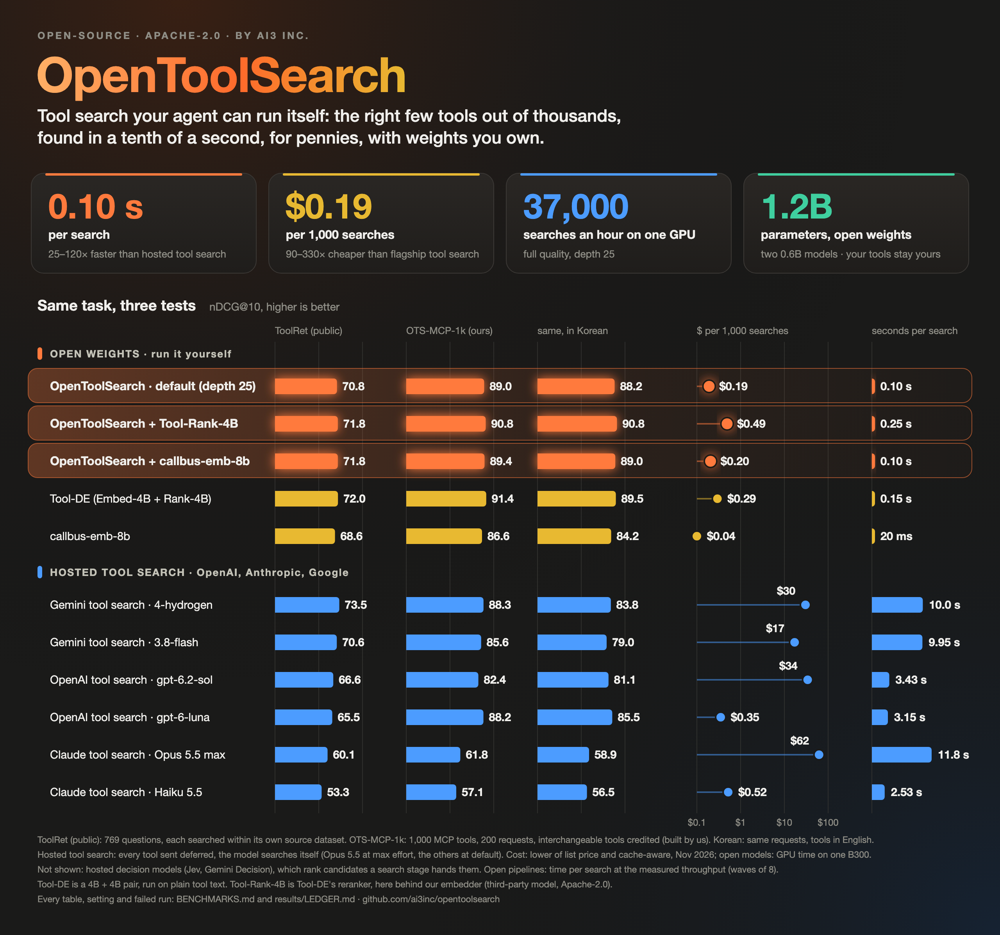

<p align="center">
  
</p>

<p align="center">
  <a href="https://huggingface.co/ai3inc/opentoolsearch-rerank-0.6b"><b>Model on Hugging Face</b></a> ·
  <a href="#benchmarks">Benchmarks</a> ·
  <a href="BENCHMARKS.md">Full benchmark tables</a> ·
  <a href="results/LEDGER.md">Every run we made</a>
</p>

# OpenToolSearch

**Open-source tool search for agents.** Give an agent a library of hundreds or thousands of
tools - function declarations, MCP servers - and let it load only the few a request needs.

Model APIs now ship this as a hosted feature. OpenToolSearch is the same idea with open weights
that you run yourself, next to any model that can call a function: an embedder (NVIDIA's
Nemotron-3-Embed-1B, used unchanged) finds the candidates and our 0.6B reranker orders them. The
reranker is the model we trained and publish; either stage can be swapped for another.

## Why OpenToolSearch

- **Fast and cheap.** 0.12 s per search and $0.24 per 1,000 on one GPU (29,000 searches an hour):
  20-100 times faster than the hosted tool search of Google, OpenAI and Anthropic, and 1.4 to 430
  times cheaper depending on the model - the cheapest hosted ones come closest.
- **Open weights, your hardware.** 1.7B parameters in all (1.14B embedder, 0.6B reranker). Your tool
  library never leaves your machines.
- **Competitive, not best, on quality.** On the public benchmark it beats OpenAI's and Claude's
  hosted tool search and Gemini 3.6-flash, ties Gemini 3.8-flash and trails gemini-4-hydrogen by
  3 points. Tool-DE, an 8B open pair, scores higher.
- **Works in Korean.** The same 200 requests in Korean cost it 1.5 points; hosted Gemini tool
  search loses 4 to 7.
- **Second among published systems on ToolRet** (58.4 nDCG@10,
  [details](BENCHMARKS.md#4-the-full-toolret-corpus-against-published-systems)), and every run we
  made, the failed ones included, is [on the record](results/LEDGER.md).

## Benchmarks

<p align="center"></p>

<!-- table:summary -->
| System | Kind | ToolRet (public) | OTS-MCP-1k (ours) | …in Korean | Cost / 1,000 searches | Median latency |
|---|---|---|---|---|---|---|
| Gemini tool search · gemini-4-hydrogen | hosted tool search | 73.5 | 88.3 | 83.8 | $30 (list $51) | 10.0 s |
| Tool-DE (4B + 4B) | open weights | 72.0 | 91.4 | 89.5 | $0.29 | 0.15 s |
| Gemini tool search · gemini-3.8-flash | hosted tool search | 70.6 | 85.6 | 79.0 | $17 (list $28) | 9.95 s |
| **OpenToolSearch** (1.14B + 0.6B) | open weights, this repo | **70.5** | **86.8** | **84.6** | **$0.24** | **0.12 s** |
| callbus-emb-8b (8B, embedding only) | open weights | 68.6 | 86.6 | 84.2 | $0.04 | 0.02 s |
| OpenAI tool search · gpt-6.2-sol | hosted tool search | 66.6 | 82.4 | 81.1 | $34 | 3.43 s |
| OpenAI tool search · gpt-6-luna | hosted tool search | 65.5 | 88.2 | 85.5 | $0.35 (list $1.74) | 3.15 s |
| Claude tool search · Opus 5.5 max effort | hosted tool search | 60.1 | 61.8 | 58.9 | $62 | 11.8 s |
| Claude tool search · Haiku 5.5 | hosted tool search | 53.3 | 57.1 | 56.5 | $0.52 | 2.53 s |
<!-- /table:summary -->

nDCG@10. **ToolRet (public)**: 769 questions, each searched within its own source dataset, the
benchmark's labels. **OTS-MCP-1k**: 1,000 MCP tools and 200 requests, built by us - weigh it below
the public one. **In Korean**: the same 200 requests, the tools stay in English. Hosted costs are
the lower of list price and cache-aware, from reported token usage (Nov 2026); open models are GPU
time on one B300.

- **Quality is competitive, not first.** OpenToolSearch (70.5 public) sits in the middle of the
  hosted tool search of the three vendors; on our own set it is 1.4 points below gpt-6-luna and
  gemini-4-hydrogen. Tool-DE (a 4B embedder plus a 4B reranker) leads the open models, and the
  hosted decision models below lead everything.
- **Speed and cost are where it wins.** 0.12 s against 2.5-12 s for hosted tool search; $0.24 per
  1,000 against $0.35 to $105 (gpt-6-luna and Haiku 5.5 are the cheap end).
- **Not in the table: Jev and Gemini Decision.** Hosted decision models rank the candidates a search
  stage hands them and cannot search a library themselves; given our first stage's candidates
  they score 77-78 on the public benchmark. [How they compare](BENCHMARKS.md#same-first-stage-fair-fight),
  and every setting and failed run, are in [BENCHMARKS.md](BENCHMARKS.md).

## Where it fits

| Your situation | What to use |
|---|---|
| A small catalogue, up to about 200 tools | A hosted decision model (Jev, Gemini Decision) on its own: given the whole pool it scored 85.7-86.3 on the small public subsets, against 75.6 for OpenToolSearch. Gemini Decision takes at most 255 options per question; we did not test either with 1,000. |
| Hundreds to thousands of tools, sub-second answers, or tool descriptions that must stay in-house | OpenToolSearch on your own GPU. |
| The best quality we measured | OpenToolSearch's embedder as the first stage and a decision model as the second: 76.8-77.3 public and 89.1-89.3 on our set at $0.36-0.64 per 1,000, against 70.5 and 86.8 at $0.24 with our reranker. |
| You already call a hosted model and want the least code | Its built-in tool search: one parameter, but seconds per search and $0.35-105 per 1,000. |

## Quick start

```bash
pip install git+https://github.com/ai3inc/opentoolsearch
```

Weights: [`ai3inc/opentoolsearch-rerank-0.6b`](https://huggingface.co/ai3inc/opentoolsearch-rerank-0.6b)
on Hugging Face (the reranker; the embedder is NVIDIA's `Nemotron-3-Embed-1B-BF16`, used unchanged).

```python
from opentoolsearch import ToolIndex

index = ToolIndex(model="nvidia/Nemotron-3-Embed-1B-BF16",
                  reranker="ai3inc/opentoolsearch-rerank-0.6b")       # the reranker is optional
index.add(tools)                       # list of tool / function declarations (dicts)
# defaults: rerank_top=25, fuse=0.5  (depth 25 ≈ depth 50 in quality, twice the throughput)

hits = index.search("refund the customer's last order", k=5)
for h in hits:
    print(h["name"], round(h["score"], 3))
```

### Deferred tool loading (client-side `tool_search`)

Send the model one function instead of your whole library; load what it asks for.

```python
search_tool = index.search_tool()              # JSON-Schema declaration for `tool_search`
# 1. call the model with tools=[search_tool]
# 2. when it calls tool_search(query=...):
loaded = index.handle(call_arguments)          # -> full declarations of the best matches
# 3. call the model again with tools=[search_tool, *loaded]
```

`examples/deferred_openai.py` is a complete loop against any OpenAI-compatible endpoint.
`index.catalogue()` gives the one-line-per-tool listing if you prefer to show the model
names and short descriptions, and `allowed=[...]` restricts a search to the tools a user
may call.

## More

- [BENCHMARKS.md](BENCHMARKS.md) - every system, condition and table; throughput and cost on rented GPUs; the full ToolRet corpus.
- [DEVELOPMENT.md](DEVELOPMENT.md) - how the model was built and trained, the validation set, how to reproduce.
- [`benchmarks/`](benchmarks/README.md) - raw data and scripts; [`results/LEDGER.md`](results/LEDGER.md) - every test run, with cost.

## Licence

Code: Apache-2.0. Models keep their base licences (see the model cards). ToolRet's data is
read from Hugging Face at pinned revisions and is not redistributed here.
