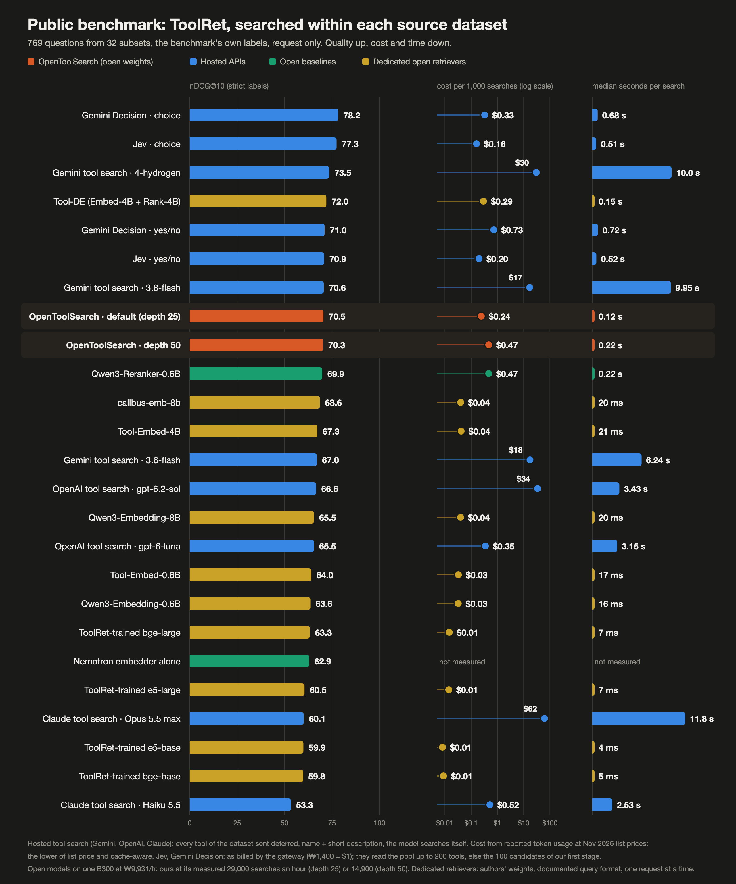
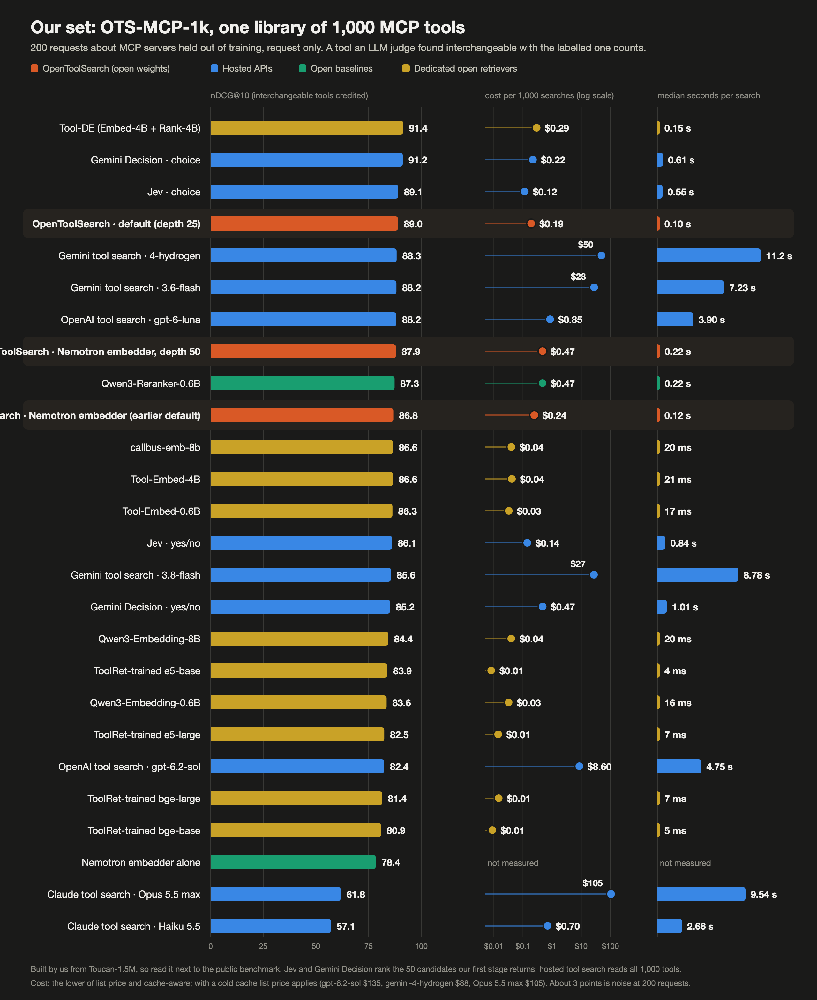
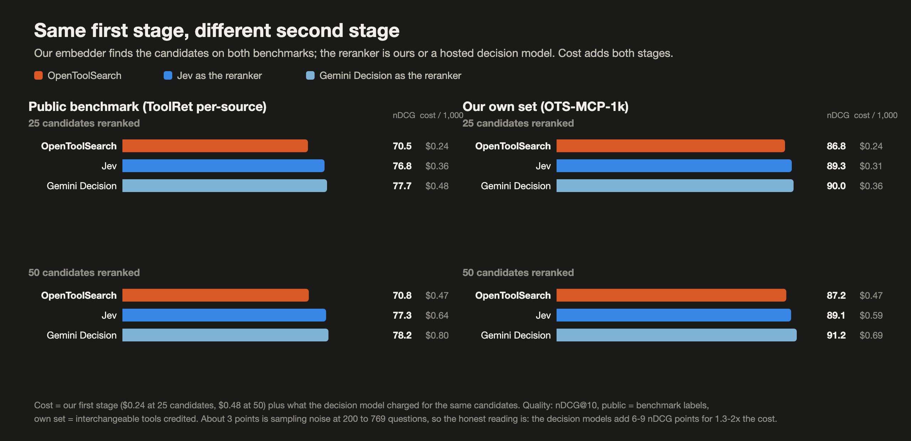

<p align="center">
  
</p>

<p align="center">
  <a href="https://huggingface.co/ai3inc/opentoolsearch-rerank-0.6b"><b>Model on Hugging Face</b></a> ·
  <a href="#benchmarks">Benchmarks</a> ·
  <a href="benchmarks/README.md">Benchmark data</a> ·
  <a href="results/LEDGER.md">Every run we made</a>
</p>

# OpenToolSearch

**Open-source tool search for agents.** Give an agent a library of hundreds or thousands of
tools - function declarations, MCP servers - and let it load only the few a request needs.

Model APIs now ship this as a hosted feature. OpenToolSearch is the same idea with open
weights that you run yourself, next to any model that can call a function:

- **29,000 searches an hour on one GPU** - 75,000 on the faster setting, two million on the
  embedder alone - at **$0.24 per 1,000 searches**, 100 to 200 times cheaper than hosted tool
  search (Gemini API tool search: $28-51 per 1,000) and about 0.12 s per search.
- **Open weights, your hardware.** No per-search fee, and the tool library never leaves your
  machines. One B300 or an H100 is enough.
- **Competitive, not best, on quality.** Between Gemini API tool search's flash and hydrogen
  tiers on our public benchmark; hosted decision models score a few points higher.
- **Second among published systems on ToolRet** (58.4 nDCG@10), with models about a fifth
  the size of the first.
- **Honest numbers.** Training rows that copy test questions were removed, the benchmark's
  labelling problem is measured, and [every test run](results/LEDGER.md) is listed - the
  ones that lost too.

Built by [AI3 Inc.](https://ai3.kr) · Apache-2.0

## One GPU, twenty-nine thousand searches an hour


The reranker is what costs time, and how many candidates it reads is a dial. Measured on one
B300 over a 1,000-tool library:

| Candidates reranked | nDCG@10 (public bench) | Per search | Searches an hour | $ per 1,000 (our pod) |
|---|---|---|---|---|
| none - embedder only | 62.9 | 1.7 ms | 2,088,000 | $0.003 |
| 10 | 67.1 | 48 ms | 75,600 | $0.09 |
| **25 (our default)** | **70.1** | 124 ms | **29,000** | **$0.24** |
| 50 | 70.3 | 241 ms | 14,900 | $0.48 |

- **The default is rerank depth 25**: two and a half times the throughput of depth 50 for 0.2
  nDCG@10 - inside the noise of this benchmark. Depth 10 is another 2.6 times faster for 3
  points.
- **One B300 does 29,000 searches an hour at full quality, 75,000 at depth 10, two million on the
  embedder alone.** A consumer app at 20 million turns a day with 0.3 tool searches each needs
  about 2,500 searches a second - roughly 100 B300s at the default depth.
- **Cost:** $0.24 per 1,000 searches at the default depth, $0.42-0.48 at depth 50, against
  Gemini API tool search's $28-51.
- The fusion weight that combines the two scores is 0.5 in the default (70.45 public / 86.77
  own set, against 70.08 / 87.43 at 0.25); the difference is inside the noise either way.
- Hosted decision models (Jev, Gemini Decision) are cheap and fast too, but they only rank the
  candidates we hand them and return a list, not a service next to your data.

## Benchmarks

Three views, published with the scripts and the raw outputs so they can be re-run
([`benchmarks/`](benchmarks/README.md)): a public benchmark against hosted services, a set of
our own, and the full ToolRet corpus against other published systems.

### 1. Public benchmark, against hosted tool search

<p align="center"></p>

[ToolRet](https://github.com/mangopy/tool-retrieval-benchmark) in its per-source setting (the
paper's Tables 10-11): each question is searched only among the tools of its own source dataset,
with the benchmark's own labels. Every subset whose pool has at most 2,000 tools is included -
32 of 35; the three left out have 3,605 to 16,072 tools, too many to hand to an API in one
request - with 25 questions per subset drawn with a fixed seed (769 in all). The
request alone, no instruction.

### 2. A set of our own

<p align="center"></p>

OTS-MCP-1k: one library of 1,000 real MCP tools and 200 requests about servers held out of
training, built by us from Toucan-1.5M. A returned tool counts if it is the labelled one or
one an LLM judge found interchangeable with it. **We built this set, so weigh it below the
public one**: the data resembles our training data, the candidates for "interchangeable" were
picked with our own embedder, and the published weights saw training rows from these servers.

### Same first stage, fair fight



The hosted decision models cannot search a library themselves, so in the table above they were
given the 50 candidates our embedder found - which means their price leaves out the search.
Here both sides use the same first stage (ours), one only swaps the second stage, and the
decision models' cost is added to it:

| Candidates | Second stage (same first stage underneath) | Public nDCG@10 | Own set nDCG@10 | Cost / 1,000 |
|---|---|---|---|---|
| 25 | **OpenToolSearch reranker** | 70.5 | 86.8 | **$0.24** |
| 25 | Jev | 76.8 | 89.3 | $0.36 |
| 25 | Gemini Decision | 77.7 | 90.0 | $0.48 |
| 50 | **OpenToolSearch reranker** | 70.8 | 87.2 | **$0.48** |
| 50 | Jev | 77.3 | 89.1 | $0.64 |
| 50 | Gemini Decision | 78.2 | 91.2 | $0.80 |

- **Only ours can be the whole pipeline.** Jev and Gemini Decision need a search stage; ours
  is the search stage. Swap the reranker for a hosted decision model and the cost goes up
  1.5-1.7x for 6-9 nDCG points.
- **At 25 candidates the gap is smaller on our set (2.5-3.3) than on the public benchmark
  (6.3-7.2)** - the public benchmark's labels are stricter.
- **Ours is 1.5x cheaper than the cheapest decision-model setup and needs no API key.**

### Both, in one table

| System | Kind | ToolRet per-source: nDCG@10 | Recall@10 | OTS-MCP-1k: nDCG@10 | Cost / 1,000 searches | Median latency |
|---|---|---|---|---|---|---|
| Gemini Decision — single choice | hosted API | 78.2 | 87.2 | 91.2 | $0.33 | 0.68 s |
| Jev — single choice | hosted API | 77.3 | 85.4 | 89.1 | $0.16 | 0.51 s |
| Gemini API tool search — gemini-4-hydrogen | hosted API | 73.5 | 79.4 | 88.3 | $51.20 | 10.03 s |
| Gemini Decision — yes/no per tool | hosted API | 71.0 | 85.4 | 85.2 | $0.73 | 0.72 s |
| Jev — yes/no per tool | hosted API | 70.9 | 84.8 | 86.1 | $0.20 | 0.52 s |
| **OpenToolSearch — default (depth 25)** | open weights | **70.5** | 82.1 | 86.8 | $0.24 | 0.12 s |
| OpenToolSearch — depth 50 | open weights | 70.3 | 82.4 | 87.9 | $0.47 | 0.22 s |
| Qwen3-Reranker-0.6B as released | open baseline | 69.9 | 81.7 | 87.3 | $0.47 | 0.22 s |
| Gemini API tool search — gemini-3.6-flash | hosted API | 67.0 | 71.6 | 88.2 | $28.01 | 6.24 s |
| Nemotron-3-Embed-1B alone | open baseline | 62.9 | 76.6 | 78.4 | — | — |

What the numbers say, plainly:

- **Default settings are depth 25 and fusion 0.5**: 70.5 on the public benchmark (depth 50
  with the same fusion: 70.8) at 29,000 searches an hour and $0.24 per 1,000 - two and a half
  times the throughput and half the cost of depth 50 for about 0.3 nDCG points, inside the
  noise of a 769-question test.
- **Quality: in the middle.** OpenToolSearch at its default (70.5) sits above Gemini API tool
  search with gemini-3.6-flash (67.0), just below it with gemini-4-hydrogen (73.5), and 7 points
  below Jev and Gemini Decision asked to pick one tool (77.3, 78.2).
- **Speed and cost: first, by a wide margin.** 0.12 s per search and $0.24 per 1,000, against
  0.5-0.7 s / $0.16-0.73 for the hosted decision models and 6-10 s / $28-51 for Gemini API tool
  search.
- **Fine-tuning adds little here.** The released Qwen3 reranker scores 69.9 on the same first
  stage at the same depth. The gain shows on the full ToolRet corpus below (51.9 to 56.0 on its
  own), where an instruction accompanies each question.
- **It is the only row you can run yourself** - open weights, no per-search fee, and the tool
  library never leaves your machines.

How to read the columns: hosted costs are what the provider or gateway charged (Gemini: its
reported token usage at list prices of Nov 2026; Jev and Gemini Decision: KRW billed by the
gateway, at 1,400 per USD). Open-model cost is GPU time for one request at a time on one NVIDIA
B300 at the ₩9,931/h list price of the GPU we rented - no batching or concurrency, so a busy
server would be cheaper per search and an idle one more expensive. Latency for hosted APIs is
the wall-clock time of the API call from our network. Jev and Gemini Decision read the whole
tool pool when it has at most 200 tools (22 of the 32 public subsets) and otherwise the 100
candidates of our first stage (50 on OTS-MCP-1k); on the 22 full-pool subsets they score
85.7 and 86.3 (single choice) against our 75.6. Their "single choice" mode returns a
probability per tool rounded to two decimals; ties keep the order the tools were listed in.
Gemini API tool search returned 3.5 (flash) and 4.7 (hydrogen) tools per question, did not
search at all on 38 and 39 questions, and returned an error on 6 and 0; those count as
misses. One question with an empty request is excluded for every system.

**Throughput, one GPU.** Measured on an NVIDIA B300 over the 1,000-tool library:

| How requests arrive | Time per search | Searches per second | Searches per hour | $ per 1,000 (our pod, $7.09/h) |
|---|---|---|---|---|
| One at a time (p50) | 0.216 s | 4.6 | 16,700 | **$0.42** |
| Served together (4 to 32 at once) | 0.239 s | 4.2 | 15,000 | **$0.47** |

One B300 answers about **15,000 tool searches an hour** - 250 a minute - on a library of 1,000
tools, whoever is calling. Concurrency does not lower the cost per search here: one search's
rerank batch already fills the GPU, so serving requests together only stops the card idling
between them. What that means in practice: at $7.09/GHz-h a search costs **$0.00047** - five
hundredths of a cent - and a busy server's per-search time stays under a quarter second.

**What it costs at market GPU prices.** Search time x the B300's price:

| B300 price source | $/GPU-hour | $/1,000 searches (1,000-tool) | $/1,000 (public pools) |
|---|---|---|---|
| Runpod, community cloud | 6.94 | **0.41** | **0.36** |
| our own pods (₩9,931/h) | 7.09 | 0.42 | 0.36 |
| Oracle, 3-year commitment | 7.50 | 0.44 | 0.39 |
| Runpod, secure cloud | 8.99 | 0.53 | 0.46 |
| Nebius | 9.50 | 0.56 | 0.49 |
| market median (45 providers) | 10.76 | 0.63 | 0.55 |
| Spheron / Verda | 11.47-11.93 | 0.67-0.70 | 0.59-0.61 |
| Oracle, on-demand | 15.00 | 0.88 | 0.77 |
| AWS capacity block (prepaid) | 16.15 | 0.95 | 0.83 |

- **Cheaper than the cheapest hosted price for tool search by 30 to 60 times.** Gemini API tool
  search costs $28-51 per 1,000 searches; on the most expensive B300 quote ours is under $1.
- Even priced against the hosted decision models ($0.16-0.73 per 1,000, but those read only the
  candidates we give them), the gap is small, and **only ours is open weights on your own metal**.
- The H100: not measured (every H100 on our cluster is rented out for days). At Runpod's $4.39/h
  and the memory-bandwidth ratio it comes to about $0.23 per 1,000 - cheaper per search, slower.
- **CPU works, slowly:** 8 vCPU, fp32, p50 57.5 s per search, $7.61 per 1,000.

### 3. The full ToolRet corpus, against published systems

<p align="center"></p>

ToolRet (ACL 2025): 7,961 questions, 44,453 tools from 35 source datasets. Every question
is searched against **all** tools in one pool. nDCG@10; the headline is the mean of the three
categories (web, code, customized), each the mean of its subsets - the paper's aggregation.

**Question + instruction**

| System | Size | nDCG@10 | Notes |
|---|---|---|---|
| MagicSelector | LLM query decomposition + 4B embedder + 4B reranker | 59.90 | as reported, arXiv 2607.17751 |
| **opentoolsearch, track B** | 1.14B embedder + 0.6B reranker | **58.48** | track A data + the *training* split of Gorilla APIBench; top 50 |
| **opentoolsearch, track A** | 1.14B embedder (as released) + 0.6B reranker | **58.37** | clean ToolRet-train + two outside sources; reranking the top 100 (58.15 with the top 50) |
| Tool-DE (Tool-Embed-4B + Tool-Rank-4B) | 4B + 4B, LLM-expanded tool docs | 57.01 | as listed in the MagicSelector paper (56.44 in its own, arXiv 2510.22670) |
| Open-weights pipeline, nothing trained | 1.5B embedder + BM25 + 1B reranker | 55.33 | as reported, Savirinc/toolret-open-weights |
| callbus-emb-8b, embedding only | 8B | 54.36 (FP8: 54.53) | as reported on its model card |
| Nemotron-3-Embed-1B, as released | 1.14B | 52.42 | our run; the first stage of both tracks |

So: **not the top of the table.** opentoolsearch is 1.5 points (track A) below the best reported
system, and above every other system we found, with models roughly a fifth of the size and
no LLM call at query time. Other systems' numbers are their authors'; we did not re-run them.

Two more views of the same track A run:

| | opentoolsearch track A | Best other figure we found |
|---|---|---|
| Question alone (no instruction), category mean, top 50 | **42.42** | 41.96 (open-weights pipeline) |
| Question + instruction, all questions pooled, top 100 | **62.47** | 59.36 (callbus-emb-8b + Qwen3-Reranker-8B) |

Track A with instruction, top 100: Recall@10 68.00, Completeness@10 56.26.

**How to read these numbers**

- The fusion weight is the only thing tuned against test questions, and it is *cross-fitted*:
  the questions are split in two halves, the weight is picked on one half and scored on the
  other, both ways. With the top 100, a fixed w = 0.25 gives 58.37 and w = 0.5 gives 58.19.
- Model choices (which base, whether to fine-tune the embedder, the augmentation) were made
  while looking at test scores. Every such run is listed in
  [`results/LEDGER.md`](results/LEDGER.md), including the ones that lost.
- ToolRet's instructions were written by a model that was shown the answer tools (the
  paper's "target-aware strategy"), so the with-instruction setting is easier than a plain
  request. The no-instruction row is the closer one to production traffic.
- Many subsets are small (11 to 50 questions). Differences under about half a point between
  runs are within what changes from one training run to the next.
- Track B uses in-domain training data for 3 of the 35 subsets (the Gorilla ones); read it
  as a supervised result for those, not as generalisation.
- The 18,422 training rows we removed are near-copies of test questions. Systems trained on
  ToolRet-train without such a filter have seen (close copies of) some test questions; we
  cannot tell from the outside how much that helps them.

## Quick start

```bash
pip install git+https://github.com/ai3inc/opentoolsearch
```

Weights: [`ai3inc/opentoolsearch-rerank-0.6b`](https://huggingface.co/ai3inc/opentoolsearch-rerank-0.6b)
on Hugging Face. Developed by AI3 Inc.

```python
from opentoolsearch import ToolIndex

index = ToolIndex(model="nvidia/Nemotron-3-Embed-1B-BF16",
                  reranker="ai3inc/opentoolsearch-rerank-0.6b")       # reranker is optional
index.add(tools)                       # list of tool / function declarations (dicts)
# defaults: rerank_top=25, fuse=0.5  (depth 25 ≈ depth 50 in quality, twice the throughput)

hits = index.search("refund the customer's last order", k=5)
for h in hits:
    print(h["name"], round(h["score"], 3))
```

### Deferred tool loading (client-side `tool_search`)

Send the model one function instead of your whole library; load what it asks for.

```python
search_tool = index.search_tool()              # JSON-Schema declaration for `tool_search`
# 1. call the model with tools=[search_tool]
# 2. when it calls tool_search(query=...):
loaded = index.handle(call_arguments)          # -> full declarations of the best matches
# 3. call the model again with tools=[search_tool, *loaded]
```

`examples/deferred_openai.py` is a complete loop against any OpenAI-compatible endpoint.
`index.catalogue()` gives the one-line-per-tool listing if you prefer to show the model
names and short descriptions, and `allowed=[...]` restricts a search to the tools a user
may call.

## Round 2: a validation set of our own

ToolRet labels one tool per need even when the pool holds interchangeable copies, and its
instructions were written with the answer in view. Round 2 therefore chose on a separate set,
**OTS-MCP dev** (738 questions about 67 MCP servers held out of training, 24,188-tool pool,
instructions written from the request alone, strict and equivalence-credited scoring), and
touched the ToolRet test questions once.

- Removing training "negatives" that are the same tool as a positive (5.6% of ToolRet-train's,
  21.9% of Toucan's, 49.6% of Glaive's) and showing half the questions without an instruction
  gave about +1 nDCG@10 on OTS-MCP dev and -0.4 on ToolRet (57.96) - both inside noise. The
  published weights stay the round-1 ones.
- On ToolRet, 47.6% of the questions where the top result is "wrong" have a top result an LLM
  judge found interchangeable with a labelled tool; crediting them, top-1 accuracy goes from
  57.2% to 77.6%.

Scripts: `scripts/v2_build_dev.py`, `v2_equiv_candidates.py`, `judge_equiv.py`,
`v2_make_train.py`, `v2_eval_dev.py`, `v2_ablate.sh`, `v2_final.sh`. Numbers: `results/LEDGER.md`.

## How it was built

**Two stages, both small.**

1. *First stage* - `nvidia/Nemotron-3-Embed-1B-BF16` (1.14B parameters), used as released:
   every tool is embedded once, a request is embedded and the top 100 (or 50) tools are taken.
2. *Second stage* - `opentoolsearch-rerank-0.6b`, a cross-encoder fine-tuned from
   `Qwen/Qwen3-Reranker-0.6B`. It reads the request (and the instruction, when there is
   one) next to each candidate's definition.
3. *Fusion* - the final score is `z(rerank) + w * z(first stage)`, both z-normalised over
   the candidates of the request.

**What we found on the way (all numbers in `results/LEDGER.md`).**

- *Fine-tuning a retriever on ToolRet-train teaches it a layout, not just the task.* The
  training set covers three sources (ToolBench, APIGen, ToolACE). After fine-tuning, scores
  on those three rise and scores on the other 32 subsets fall, because the model starts to
  prefer tools written in the three layouts it was trained on.
- *Layout augmentation fixes that.* During training every tool definition is re-rendered in
  a random layout (renamed and reordered keys, wrapped or unwrapped, JSON / YAML-like /
  Python-signature). Without it the embedder dropped from 52.4 to 51.0 in 80 steps; with it
  the 32 unseen-source subsets held (51.3 -> 51.1) while the three seen sources gained
  (64.9 -> 68.6). See `opentoolsearch/augment.py`.
- *A weight average beats both of its halves.* Averaging the fine-tuned reranker's weights
  50/50 with the released reranker's gave 55.98 nDCG@10 on its own, against 51.68 for the
  fine-tuned one and 51.85 for the released one. The ratio was fixed at 0.5 beforehand and
  not tuned.
- *The two stages disagree usefully.* The reranker alone (55.98) and the embedder alone
  (52.42) fuse to 58.2.
- *The embedder is best left alone here.* Fine-tuned embedders gave the reranker a worse
  candidate list than the released one (57.3 vs 58.2 after reranking), so the released
  embedder is the first stage.

**Training data for the reranker.** 14,400 groups (300 steps x 48) of one relevant tool and
seven hard negatives, drawn from:

- ToolRet-train with every row removed whose question copies or nearly copies a ToolRet
  test question: normalised exact match, word-set Jaccard >= 0.60, or embedding cosine
  >= 0.92 against the nearest test questions. **18,422 of 208,826 rows were removed**
  (1,866 distinct test questions had a copy in the training set); 2,000 more rows are held
  out as a dev set. `scripts/prep_train.py`.
- 81,542 rows from two sources that are not among ToolRet's 35: real MCP-server tools from
  Toucan-1.5M and function-calling dialogues from Glaive v2 (both Apache-2.0), filtered with
  the same rule. Their retrieval instructions were written by an LLM in ToolRet's style.
- Hard negatives are the first stage's own top results for each training question.

## Reproduce

```bash
pip install -e ".[train]"
python -m opentoolsearch.evaluate --model nvidia/Nemotron-3-Embed-1B-BF16 --inst --template concat \
    --q_prefix "query: " --doc_prefix "passage: " --out results/first_stage
python -m opentoolsearch.rerank eval --model ai3inc/opentoolsearch-rerank-0.6b --run results/first_stage/run_inst_concat.json \
    --inst --topn 100 --out results/reranked
python scripts/fuse.py results/first_stage/run_inst_concat.json results/reranked/run_inst.json 0 0.25 0.5 1
```

Training data and steps: `scripts/prep_train.py` (clean ToolRet-train), `scripts/prep_external.py`
and `scripts/gen_instructions.py` (Toucan / Glaive rows), `scripts/mine_negs.py`,
`python -m opentoolsearch.rerank train ...`. Every test evaluation we ran is in
[`results/LEDGER.md`](results/LEDGER.md).

## Status

- `opentoolsearch-rerank-0.6b` is published on Hugging Face (Apache-2.0). It is a weight average
  of `Qwen/Qwen3-Reranker-0.6B` and our fine-tune of it. The first stage,
  `nvidia/Nemotron-3-Embed-1B-BF16`, is NVIDIA's model under the OpenMDW-1.1 licence and is
  used unchanged.
- The track B and round-2 weights are experiments and are not published.
- Submitted to the ToolRet leaderboard (pull request on the Space; not merged at the time of
  writing).
- `scripts/push.sh`, `watch_eval.sh`, `baselines.sh`, `v2_ablate.sh`, `v2_final.sh` are the
  helpers we ran on our own GPU pod; paths in them are ours.

## Licence

Code: Apache-2.0. Models keep their base licences (see the model cards). ToolRet's data is
read from Hugging Face at pinned revisions and is not redistributed here.
