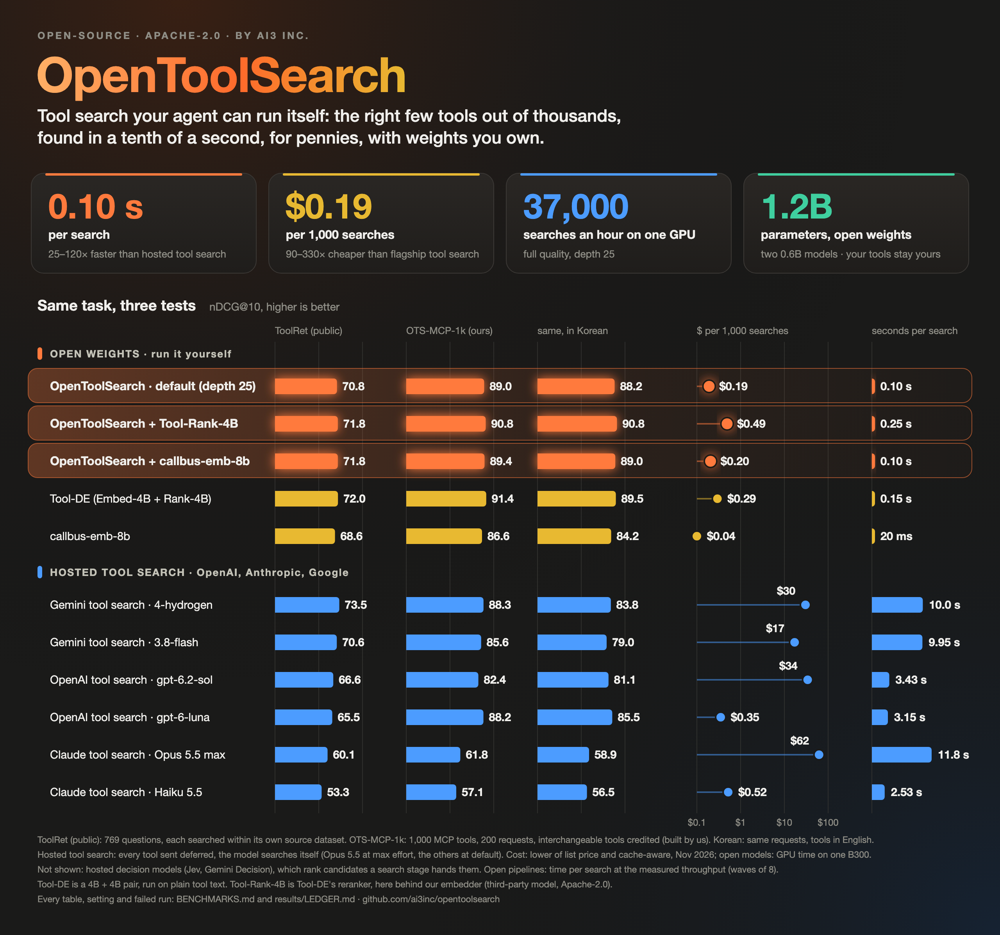

# OpenToolSearch Embed 0.6B

**A small embedder that finds the tools a request needs.** Developed by **AI3 Inc.**

Agents now carry hundreds or thousands of tool definitions (function declarations, MCP
tools). Putting all of them in the prompt costs tokens and makes the model choose worse.
*Tool search* fixes that: keep the library out of the prompt, find the few tools a request
needs, load only those. Model APIs have started to offer this on the server side;
OpenToolSearch is the open version you run yourself, with any model.

This repository is the first stage of that search: it embeds every tool once, embeds each request,
and hands the 25 closest tools to the reranker,
[`ai3inc/opentoolsearch-rerank-0.6b`](https://huggingface.co/ai3inc/opentoolsearch-rerank-0.6b).
Together they are **OpenToolSearch**: two 0.6B models, both Apache-2.0.

| | |
|---|---|
| Developed by | AI3 Inc. |
| Model type | Text embedder (sentence-transformers: last-token pooling, L2-normalised) |
| Base model | [`Qwen/Qwen3-Embedding-0.6B`](https://huggingface.co/Qwen/Qwen3-Embedding-0.6B), fine-tuned for tool retrieval |
| Parameters | 0.6B (bfloat16, 1.2 GB); 1,024-dimensional vectors |
| Input length | up to 512 tokens per tool definition in every benchmark below |
| Pairs with | [`ai3inc/opentoolsearch-rerank-0.6b`](https://huggingface.co/ai3inc/opentoolsearch-rerank-0.6b) |
| Language | English; tested on Korean requests (one set, see Results) |
| Licence | Apache-2.0 |

## Highlights

- **A small first stage that holds its own.** Behind our reranker it reaches 70.8 / 89.0 / 88.2
  nDCG@10 (ToolRet public benchmark / our own set / the same set in Korean) - above NVIDIA's 1.14B
  Nemotron-3-Embed-1B in the same slot (70.4 / 86.2 / 84.7) with half the parameters, and within
  1.0 / 0.4 / 0.8 points of the 7.6B callbus-emb-8b (71.8 / 89.4 / 89.0).
- **Better than its base on its own.** As a first stage alone it scores 66.0 / 85.9 / 80.4 against
  63.6 / 83.6 / 79.0 for Qwen3-Embedding-0.6B, and puts every labelled tool in the top 25 for 98% of
  our own-set requests (base: 96%).
  Behind the reranker the two are close (70.8 against 70.6 on the public benchmark; the 200-request
  sets cannot separate 1-2 points) - the second stage does most of the work.
- **Fast, cheap, yours.** Embedding a request takes a few milliseconds; the whole pair answers in a median
  66 ms (0.10 s per search at full throughput, 37,000 an hour) and costs $0.19 per 1,000 searches on one B300. Open weights: your tool library never
  leaves your machines.
- **English first, Korean tested.** Trained mainly on English; Korean requests over English tool
  descriptions cost 0.8 points on our set. Other languages were not evaluated.

## Benchmarks



<!-- table:summary -->
| System | Kind | ToolRet (public) | OTS-MCP-1k (ours) | …in Korean | Cost / 1,000 searches | Median latency |
|---|---|---|---|---|---|---|
| Gemini tool search · gemini-4-hydrogen | hosted tool search | 73.5 | 88.3 | 83.8 | $30 (list $51) | 10.0 s |
| Tool-DE (4B + 4B) | open weights | 72.0 | 91.4 | 89.5 | $0.29 | 0.15 s |
| **OpenToolSearch reranker behind callbus-emb-8b** (7.6B + 0.6B) | open weights, this repo's reranker | **71.8** | **89.4** | **89.0** | $0.20 | 0.10 s |
| **OpenToolSearch embedder + Tool-Rank-4B** (0.6B + 4B) | open weights, this repo's embedder, Tool-DE's reranker | **71.8** | **90.8** | **90.8** | $0.49 | 0.25 s |
| **OpenToolSearch** (0.6B + 0.6B) | open weights, this repo | **70.8** | **89.0** | **88.2** | **$0.19** | **0.10 s** |
| Gemini tool search · gemini-3.8-flash | hosted tool search | 70.6 | 85.6 | 79.0 | $17 (list $28) | 9.95 s |
| callbus-emb-8b (8B, embedding only) | open weights | 68.6 | 86.6 | 84.2 | $0.04 | 0.02 s |
| OpenAI tool search · gpt-6.2-sol | hosted tool search | 66.6 | 82.4 | 81.1 | $34 | 3.43 s |
| OpenAI tool search · gpt-6-luna | hosted tool search | 65.5 | 88.2 | 85.5 | $0.35 (list $1.74) | 3.15 s |
| Claude tool search · Opus 5.5 max effort | hosted tool search | 60.1 | 61.8 | 58.9 | $62 | 11.8 s |
| Claude tool search · Haiku 5.5 | hosted tool search | 53.3 | 57.1 | 56.5 | $0.52 | 2.53 s |
<!-- /table:summary -->

nDCG@10. **ToolRet (public)**: 769 questions, each searched within its own source dataset, the
benchmark's labels, request only. **OTS-MCP-1k**: 1,000 MCP tools and 200 requests, built by us - weigh it
below the public one. **In Korean**: the same requests, tools in English. Hosted costs are the lower of
list price and cache-aware, from reported token usage (Nov 2026); open models are GPU time on one B300. Their latency is the time per search at full throughput (waves of 8 requests); a single request takes a median 66 ms.

The same reranker behind other first stages, on the three tests (the reranker reads the top 25):

<!-- table:firststage -->
| First stage | Alone (public / own / Korean) | + OpenToolSearch reranker | Gain | Every labelled tool in the top 25 |
|---|---|---|---|---|
| callbus-emb-8b (7.6B) | 68.6 / 86.6 / 84.2 | **71.8 / 89.4 / 89.0** | +3.2 / +2.8 / +4.8 | 84% / 100% / 98% |
| Nemotron-3-Embed-8B (8B) | 66.1 / 81.6 / 77.7 | **71.2 / 87.1 / 86.3** | +5.2 / +5.5 / +8.6 | 83% / 95% / 93% |
| Qwen3-Embedding-8B (7.6B) | 65.5 / 84.4 / 82.9 | **71.0 / 88.5 / 88.4** | +5.6 / +4.1 / +5.5 | 84% / 98% / 98% |
| Tool-Embed-4B (4.0B) | 67.3 / 86.6 / 81.5 | **71.0 / 89.2 / 85.8** | +3.7 / +2.6 / +4.3 | 82% / 98% / 95% |
| OpenToolSearch-Embed-0.6B (0.6B) - the library default | 66.0 / 85.9 / 80.4 | **70.8 / 89.0 / 88.2** | +4.8 / +3.1 / +7.7 | 83% / 98% / 98% |
| Qwen3-Embedding-0.6B (0.6B) - the base of OpenToolSearch Embed | 63.6 / 83.6 / 79.0 | **70.6 / 87.3 / 87.2** | +7.0 / +3.7 / +8.2 | 82% / 96% / 94% |
| Nemotron-3-Embed-1B (1.14B) - the library default before 0.2 | 63.0 / 79.0 / 74.0 | **70.4 / 86.2 / 84.7** | +7.4 / +7.2 / +10.7 | 81% / 94% / 92% |
| Tool-Embed-0.6B (0.6B) | 64.0 / 86.3 / 78.0 | **69.3 / 89.3 / 85.8** | +5.2 / +2.9 / +7.9 | 81% / 98% / 94% |
<!-- /table:firststage -->

Every system, setting and failed run: [github.com/ai3inc/opentoolsearch](https://github.com/ai3inc/opentoolsearch/blob/main/BENCHMARKS.md).

## Use

### With sentence-transformers

```python
from sentence_transformers import SentenceTransformer

model = SentenceTransformer("ai3inc/opentoolsearch-embed-0.6b")
model.max_seq_length = 512

tools = ['{"name": "get_weather_forecast", "description": "Get the weather forecast for a city on a given date."}',
         '{"name": "create_invoice", "description": "Create an invoice for a customer."}']
doc = model.encode(tools, normalize_embeddings=True)                       # tools: no prompt
q = model.encode_query("What's the weather in Seoul tomorrow?", normalize_embeddings=True)   # applies the query prompt
print(doc @ q)
```

The query prompt is stored in the model's configuration
(`Instruct: Given an agent's request for a tool, retrieve the MCP tool that fulfills it.\nQuery: `);
tool definitions are embedded as they are, as JSON text.

### With the OpenToolSearch library (embedder + reranker, one call)

```python
# pip install git+https://github.com/ai3inc/opentoolsearch
from opentoolsearch import ToolIndex

index = ToolIndex()                               # downloads both models
index.add(tools)                                  # OpenAI / Anthropic / Gemini / MCP style dicts
hits = index.search("refund the customer's last order", k=5)

# Deferred loading: give the model one function instead of the whole library
search_tool = index.search_tool()                 # declaration of `tool_search`
loaded = index.handle(call_arguments)             # full declarations of the best matches
```

## How it was made

Fine-tuned from `Qwen/Qwen3-Embedding-0.6B` for tool retrieval on one NVIDIA B300. The training
recipe is not published. Weights, tokenizer and architecture are the base model's, with changed weights.

### Training data

| Source | Notes |
|---|---|
| ToolRet-Training (ToolBench, APIGen, ToolACE) | Requests that copy or nearly copy a ToolRet test question were removed. |
| Toucan-1.5M (real MCP-server tools) | Apache-2.0. Every row that touches an MCP server held out for OTS-MCP-1k was removed. |
| Machine-translated Korean requests | About 4% of the training groups: Korean versions of Toucan requests (not of any benchmark request). |

No ToolRet test question or test label, and no request or tool of OTS-MCP-1k, was used for training.
Unlike the reranker, which saw Toucan rows from those servers, this model never saw them.

## Limits

- Trained mainly on English. Korean requests over English tools were tested on one set (88.2 nDCG@10
  behind the reranker against 89.0 in English); other languages were not evaluated.
- Evaluated on ToolRet and on one set of our own. Both are built from research and synthetic
  datasets; neither is the traffic of a live agent.
- An embedder alone ranks 25 candidates worse than it ranks the best five: use it with the
  reranker when the order inside the top 5 matters (alone 66.0 public, behind the reranker 70.8).
- When a library holds several near-identical tools from different providers, nothing in a
  request says which one is "right"; rankings among those are arbitrary.
- ToolRet's datasets state no licence. The training set above is public on the Hugging Face
  Hub, but we make no claim about the terms of the underlying source datasets.

## Licence and credits

Apache-2.0 (see `LICENSE` and `NOTICE`), as the base model Qwen3-Embedding-0.6B (Alibaba Cloud, Apache-2.0),
which this model modifies.

ToolRet: Shi et al., "Retrieval Models Aren't Tool-Savvy: Benchmarking Tool Retrieval for
Large Language Models", ACL 2025 Findings (arXiv 2503.01763). Toucan-1.5M: Agent-Ark.
Qwen3 Embedding: Zhang et al., arXiv 2506.05176.

```bibtex
@misc{opentoolsearch2026,
  title  = {OpenToolSearch: small open models for tool retrieval},
  author = {AI3 Inc.},
  year   = {2026},
  url    = {https://huggingface.co/ai3inc/opentoolsearch-embed-0.6b}
}
```
