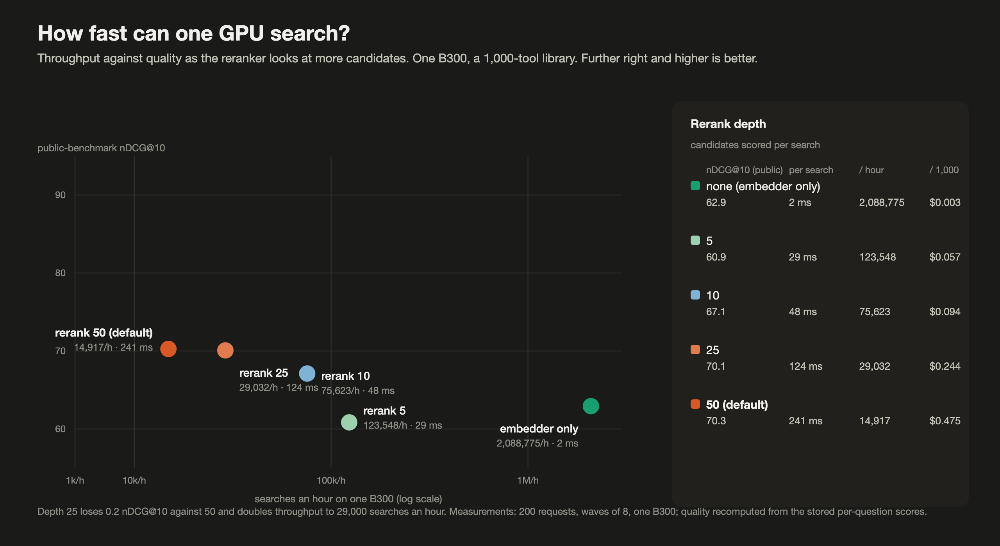
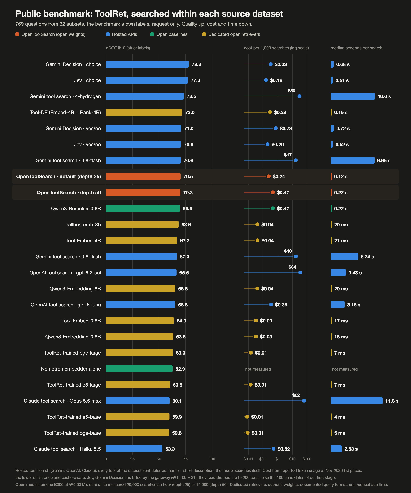

# OpenToolSearch Rerank 0.6B

**A small reranker that picks the right tools for a request.** Developed by **AI3 Inc.**

Agents now carry hundreds or thousands of tool definitions (function declarations, MCP
tools). Putting all of them in the prompt costs tokens and makes the model choose worse.
*Tool search* fixes that: keep the library out of the prompt, find the few tools a request
needs, load only those. Model APIs have started to offer this on the server side;
OpenToolSearch is the open version you run yourself, with any model.

This repository is the second stage of that search: a 0.6B cross-encoder that reads a
request next to a tool definition and scores how well the tool fits.

| | |
|---|---|
| Developed by | AI3 Inc. |
| Model type | Cross-encoder reranker (yes/no head of a causal LM) |
| Base model | [`Qwen/Qwen3-Reranker-0.6B`](https://huggingface.co/Qwen/Qwen3-Reranker-0.6B) |
| Parameters | 0.6B (bfloat16, 1.2 GB) |
| Recommended first stage | [`nvidia/Nemotron-3-Embed-1B-BF16`](https://huggingface.co/nvidia/Nemotron-3-Embed-1B-BF16), unchanged |
| Language | English |
| Licence | Apache-2.0 |

## Results

[ToolRet](https://github.com/mangopy/tool-retrieval-benchmark) (ACL 2025 Findings): 7,961
questions, 44,453 tools from 35 source datasets, every question searched against **all**
tools in one pool. nDCG@10, mean of the three categories (web, code, customized), each the
mean of its subsets - the paper's aggregation.

**Question + instruction**

| System | Size | nDCG@10 |
|---|---|---|
| MagicSelector (arXiv 2607.17751) | LLM query decomposition + 4B embedder + 4B reranker | 59.90 |
| **OpenToolSearch** (Nemotron-3-Embed-1B + this model) | 1.14B + 0.6B | **58.37** |
| Tool-DE (Tool-Embed-4B + Tool-Rank-4B) | 4B + 4B | 57.01 |
| Open-weights pipeline, nothing trained (Savirinc/toolret-open-weights) | 1.5B + BM25 + 1B | 55.33 |
| callbus-emb-8b, embedding only | 8B | 54.36 |
| Nemotron-3-Embed-1B alone (our run) | 1.14B | 52.42 |

**It is not the top of the table**: 1.5 points below the best reported system, above the
others we found, at roughly a fifth of the size and with no LLM call at query time. Other
systems' numbers are their authors'; we did not re-run them.

| Same system, other views | OpenToolSearch | Best other figure we found |
|---|---|---|
| Question alone (no instruction), top 50 reranked | **42.42** | 41.96 |
| Question + instruction, all questions pooled | **62.47** | 59.36 |

| Detail (question + instruction) | nDCG@10 | Recall@10 | Completeness@10 |
|---|---|---|---|
| Top 100 reranked | 58.37 | 68.00 | 56.26 |
| Top 50 reranked | 58.15 | 67.60 | 55.82 |
| This model's score alone, top 50 (no fusion) | 55.98 | | |

Per category at top 100: web 52.01, code 61.09, customized 62.01.

### How to read these numbers

- The final score fuses this model with the first stage:
  `z(rerank) + w * z(first stage)`, z-normalised over a request's candidates. `w` is the only
  value tuned against test questions and it is cross-fitted: the questions are split in two
  halves, `w` is picked on one half and scored on the other, both ways. A fixed `w = 0.25`
  gives 58.37, `w = 0.5` gives 58.19.
- Which base models to use, and how to train, were decided while looking at test scores.
  Every test run we made, including the ones that lost, is in the evaluation ledger shipped
  in this repository ([`LEDGER.md`](LEDGER.md)).
- ToolRet's instructions were written by a model that was shown the answer tools, so the
  with-instruction setting is easier than a plain request. The no-instruction row is closer
  to real traffic.
- Many subsets have 11 to 50 questions. Differences under about half a point are noise.

### One GPU, fifteen thousand searches an hour - or seventy-five thousand



Rerank depth is the dial. On one B300 over 1,000 tools: depth 50 gives 70.3 nDCG@10 at 14,900
searches an hour and $0.48 per 1,000; depth 25 gives 70.1 at 29,000 and $0.24; depth 10 gives
67.1 at 75,600 and $0.09; the embedder alone gives 62.9 at 2.1 million an hour for $0.003.
A large consumer app with 20 million turns a day and 0.3 tool searches each needs about 2,500
searches a second, which is roughly 200 GPUs at full quality.

### Against hosted tool search



Two tests, the request alone (no instruction). **ToolRet per-source** is the public one: each
question searched among the tools of its own source dataset, the benchmark's labels, 769
questions from 32 subsets. **OTS-MCP-1k** is ours: 1,000 MCP tools, 200 requests about held-out
servers, interchangeable tools credited - built by us, so weigh it below the public one.
Gemini Decision and Jev lead on both when asked to pick one tool (91.2 and 89.1 on ours); this
model is the fastest of them all by a wide margin.

| System | Kind | ToolRet per-source: nDCG@10 | Recall@10 | OTS-MCP-1k: nDCG@10 | Cost / 1,000 searches | Median latency |
|---|---|---|---|---|---|---|
| Gemini Decision — single choice | hosted API | 78.2 | 87.2 | 91.2 | $0.33 | 0.68 s |
| Jev — single choice | hosted API | 77.3 | 85.4 | 89.1 | $0.16 | 0.51 s |
| Gemini API tool search — gemini-4-hydrogen | hosted API | 73.5 | 79.4 | 88.3 | $51 | 10.0 s |
| Gemini Decision — yes/no per tool | hosted API | 71.0 | 85.4 | 85.2 | $0.73 | 0.72 s |
| Jev — yes/no per tool | hosted API | 70.9 | 84.8 | 86.1 | $0.20 | 0.52 s |
| **OpenToolSearch** | **open weights** | **70.3** | 82.4 | 87.9 | $0.36 | 0.16 s |
| Qwen3-Reranker-0.6B as released | open baseline | 69.9 | 81.7 | 87.3 | $0.36 | 0.16 s |
| Gemini API tool search — gemini-3.6-flash | hosted API | 67.0 | 71.6 | 88.2 | $28 | 6.24 s |
| Nemotron-3-Embed-1B alone | open baseline | 62.9 | 76.6 | 78.4 | — | — |


Hosted costs are what the provider or gateway charged; open-model cost is GPU time for one
request at a time on one NVIDIA B300 at its rental list price. Jev and Gemini Decision read the
whole tool pool when it has at most 200 tools, otherwise the candidates of our first stage.
Data, scripts and every caveat: [github.com/ai3inc/opentoolsearch](https://github.com/ai3inc/opentoolsearch#benchmarks).

### What it costs on rented GPUs

Searching 1,000 tools, one request at a time, measured at p50 0.216 s and mean 0.233 s per
search on an NVIDIA B300. Priced at what B300s rent for in the market (quotes of 19-21
November 2026):

| B300 price source | $/GPU-hour | 1,000-tool set: $/1,000 searches | Public pools: $/1,000 searches |
|---|---|---|---|
| Runpod, community cloud | 6.94 | 0.41 | 0.36 |
| Runpod, secure cloud | 8.99 | 0.53 | 0.46 |
| Nebius | 9.50 | 0.56 | 0.49 |
| Runpod cluster (on-demand) | 10.79 | 0.63 | 0.55 |
| Spheron | 11.47 | 0.67 | 0.59 |
| Verda | 11.93 | 0.70 | 0.61 |
| Oracle, on-demand | 15.00 | 0.88 | 0.77 |
| Oracle, 3-year commitment | 7.50 | 0.44 | 0.39 |
| AWS capacity block (prepaid) | 16.15 | 0.95 | 0.83 |
| market median (getdeploying) | 10.76 | 0.63 | 0.55 |
| our on-pod list price (₩9,931/h) | 7.09 | 0.42 | 0.36 |

Our own pod rents at the equivalent of about $7.09/h (₩9,931/h), so the $0.36-0.42 rows are
what the numbers elsewhere on this page use. Even at the most expensive quote, a search
costs well under a tenth of a cent - 30 to 60 times less than Gemini API tool search's $28 to
$51 per 1,000. On 8 vCPUs, without a GPU, a search takes 57 s and the cost is about $7.61 per
1,000; the H100 is not measured (all rented out), but at Runpod's $4.39/h it would be about
$0.23 per 1,000.

### A second check: MCP servers the model never saw

ToolRet's instructions were written with the answer in view, and its labels accept only one
of several interchangeable tools. So we built a validation set of our own (OTS-MCP dev):
738 questions about 67 MCP servers held out of training, searched in a pool of 24,188 tools;
the instruction, when used, is written from the request alone. *Strict* counts only the
labelled tool; *credited* also accepts a tool an LLM judged interchangeable with it.

nDCG@10, reranker score alone, strict / credited:

| | request alone | request + instruction |
|---|---|---|
| Nemotron-3-Embed-1B alone | 32.84 / 53.26 | 37.72 / 61.23 |
| Qwen3-Reranker-0.6B as released | 39.75 / 66.06 | 41.06 / 69.23 |
| This model's recipe, retrained without the held-out servers | 44.80 / 68.00 | 47.20 / 71.60 |
| + same-tool "negatives" removed, half the questions without instruction (round 2) | 45.21 / 69.02 | 47.35 / 72.90 |

The published weights themselves saw training rows from those servers, so they are not scored
here; the third row is the same recipe trained without them. The round-2 variant is about one
point better on this set and 0.4 lower on ToolRet (57.96) - both within noise - so the
published weights are unchanged.

### How much of the benchmark's "error" is labelling

On ToolRet, this system's top result is a labelled tool for 57.2% of the questions. For the
rest, an LLM judge found the top result interchangeable with a labelled tool in 47.6% of
cases; crediting those, top-1 accuracy is 77.6%. Tool libraries pooled from many sources
contain the same tool many times, and a benchmark that labels one copy undercounts every
system. One judge, no human check; details in `LEDGER.md`.

## Use

### With transformers only

```python
import torch
from transformers import AutoModelForCausalLM, AutoTokenizer

name = "ai3inc/opentoolsearch-rerank-0.6b"
tok = AutoTokenizer.from_pretrained(name, padding_side="left")
model = AutoModelForCausalLM.from_pretrained(name, torch_dtype=torch.bfloat16).eval()
yes, no = tok.convert_tokens_to_ids("yes"), tok.convert_tokens_to_ids("no")

PRE = ('<|im_start|>system\nJudge whether the Document meets the requirements based on the Query and the '
       'Instruct provided. Note that the answer can only be "yes" or "no".<|im_end|>\n<|im_start|>user\n')
SUF = "<|im_end|>\n<|im_start|>assistant\n<think>\n\n</think>\n\n"
DEFAULT = "Given a user request, retrieve the tools that are needed to fulfil it"

def score(request, tool_json, instruction=None):
    text = f"{PRE}<Instruct>: {instruction or DEFAULT}\n<Query>: {request}\n<Document>: {tool_json}{SUF}"
    ids = tok(text, return_tensors="pt", add_special_tokens=False).to(model.device)
    with torch.no_grad():
        logits = model(**ids).logits[0, -1]
    return (logits[yes] - logits[no]).item()          # higher = better fit

tool = '{"name": "get_weather_forecast", "description": "Get the weather forecast for a city on a given date."}'
print(score("What's the weather in Seoul tomorrow?", tool))
```

### With the OpenToolSearch library

Index, fused two-stage search, and a drop-in `tool_search` function for deferred tool loading:
[github.com/ai3inc/opentoolsearch](https://github.com/ai3inc/opentoolsearch)
(`pip install git+https://github.com/ai3inc/opentoolsearch`). The repository also holds the
evaluation and training code behind every number on this page.

```python
from opentoolsearch import ToolIndex

index = ToolIndex(model="nvidia/Nemotron-3-Embed-1B-BF16",
                  reranker="ai3inc/opentoolsearch-rerank-0.6b")
index.add(tools)                                  # OpenAI / Anthropic / Gemini / MCP style dicts
hits = index.search("refund the customer's last order", k=5)

# Deferred loading: give the model one function instead of the whole library
search_tool = index.search_tool()                 # declaration of `tool_search`
loaded = index.handle(call_arguments)             # full declarations of the best matches
```

`instruction` is optional: one line saying what kind of tool is needed, in ToolRet's style
("Given a `weather` task, retrieve tools that return a forecast for a location and date").
An agent can write it itself when it calls `tool_search`.

**Recommended pipeline.** Embed every tool once with the first-stage model, take the top
50-100 for a request, score those with this model, and rank by
`z(rerank) + 0.25 * z(first stage)`. Reranking fewer candidates is faster and a little
worse (top 30: about 0.4 points lower than top 50 in our runs).

## How it was made

- **Fine-tuned** from `Qwen/Qwen3-Reranker-0.6B` for 300 steps of 48 groups (one relevant
  tool + seven hard negatives; listwise cross-entropy plus a pointwise term), learning rate
  6e-6, on one NVIDIA B300.
- **Weight-averaged** 50/50 with the released base model. On ToolRet the average scores
  55.98 on its own, the fine-tuned weights 51.68 and the base 51.85. The ratio was fixed at
  0.5 beforehand.
- **Layout augmentation.** Tool libraries write the same tool in many layouts. During
  training every tool definition was re-rendered in a random one (renamed and reordered
  keys, wrapped or unwrapped, JSON / YAML-like / Python signature), so that the model
  cannot learn "tools that look like my training set are the relevant ones". Without this,
  fine-tuning raised scores on the training sources and lowered them everywhere else.
- **Hard negatives** are the first-stage model's own top results for each training question.

### Training data

| Source | Rows | Notes |
|---|---|---|
| ToolRet-Training-20w (ToolBench, APIGen, ToolACE) | 188,404 used of 208,826 | **18,422 rows removed** because the question copies or nearly copies a ToolRet test question (normalised exact match, word-set Jaccard >= 0.60, or embedding cosine >= 0.92); 2,000 more held out |
| Toucan-1.5M (real MCP-server tools) | 64,510 | Apache-2.0; same near-copy filter |
| Glaive function-calling v2 | 17,032 | Apache-2.0; same near-copy filter |

The retrieval instructions for the Toucan and Glaive rows were written by an LLM in
ToolRet's style. No ToolRet test question or test label was used for training. Only
14,400 groups were sampled from this pool, so the model has seen a small part of it.

## Limits

- English only; not evaluated on other languages.
- Evaluated on ToolRet and on one validation set of our own. Both are built from research
  and synthetic datasets; neither is the traffic of a live agent.
- A cross-encoder runs once per candidate. Budget for 50-100 forward passes per search
  (or fewer, at some cost in quality); the first-stage embedder decides what it gets to see.
- When a library holds several near-identical tools from different providers, nothing in a
  request says which one is "right"; rankings among those are arbitrary.
- ToolRet's datasets state no licence. The training set above is public on the Hugging Face
  Hub, but we make no claim about the terms of the underlying source datasets.

## Licence and credits

Weights: Apache-2.0, as the base model `Qwen/Qwen3-Reranker-0.6B`. The recommended
first-stage model `nvidia/Nemotron-3-Embed-1B-BF16` is NVIDIA's, under the OpenMDW-1.1
licence, and is not included here.

ToolRet: Shi et al., "Retrieval Models Aren't Tool-Savvy: Benchmarking Tool Retrieval for
Large Language Models", ACL 2025 Findings (arXiv 2503.01763). Toucan-1.5M: Agent-Ark.
Glaive function-calling v2: Glaive AI.

```bibtex
@misc{opentoolsearch2026,
  title  = {OpenToolSearch: small open models for tool retrieval},
  author = {AI3 Inc.},
  year   = {2026},
  url    = {https://huggingface.co/ai3inc/opentoolsearch-rerank-0.6b}
}
```
